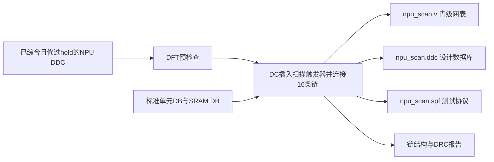
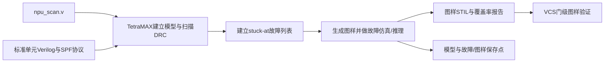
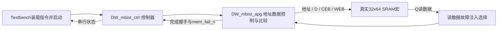

# 从零读懂本项目的扫描链、ATPG 和 MBIST

更新提示（2026-10-19）：后续ATPG已保存16502条图样，Test coverage 92.19%、Fault coverage 78.58%。本篇保留104条图样、900秒预算等早期教学快照；最新成果、流程复习和面试问答见 [dft_scan_interview_notes.md](/home/ICer/eda/npu-vcs-learning/docs/dft_scan_interview_notes.md)。最新图样尚未重新做VCS验证。

整理日期：2026-10-19。本文对应 `learning/vcs-pe` 分支和本机已实际执行的实验，不是已经完成芯片测试签核的声明。本文只整理知识和证据，没有启动新的综合、ATPG 或仿真。

建议先读第 1～4 节建立电路概念，再看脚本。遇到长路径可以先把它理解成“这份输入文件在哪里”，不必记住路径字符串。

## 1. 我们现在究竟完成了什么

| 工作 | 当前实际状态 | 还不能据此声称什么 |
|---|---|---|
| NPU 扫描链 | DC 插入 16 条普通链，共 75137 个扫描触发器 | 不能说扫描后功能/移位时序已经全部收敛 |
| 扫描规则检查 | 75137 个时序单元没有扫描资格违规；TetraMAX 能追踪全部链 | DC 仍有 16 个硬 SRAM 的 TEST-451 建模告警，并非所有检查零告警 |
| NPU stuck-at ATPG | 最新保存 104 条图样；Test coverage 64.96%，Fault coverage 56.59% | 达到本轮时间预算而停止，还没有完成覆盖率收敛 |
| 图样门级仿真 | 此前 14 条集合中的前 10 条，VCS 抽样结果 0 mismatches | 不是全部 104 条的完整串行链验证，也没有 SDF 时序验证 |
| MBIST | 厂家控制器＋APG＋一块真实 32×64 SRAM，正常/故障注入用例均 PASS | 还没有接入 NPU 的全部 16 个宏，没有测得 SRAM 全故障覆盖率 |

当前没有 ATPG 进程在运行。最新一轮在 2026-10-19 达到 900 CPU 秒预算后正常保存退出。

本次参与的工具：DC/DFT Compiler 修改电路；TetraMAX 生成逻辑故障测试图样并统计覆盖率；VCS 检查图样或 MBIST 电路的仿真行为。不是我手工给 75137 个寄存器一根根连线，也不是我手写了 104 条测试向量。我的工作是配置、编写接口与脚本、运行、分析失败、修正并复验。

## 2. 为什么功能仿真之外还要做这些

平时的 RTL testbench 检查“设计意图是否正确”：例如输入矩阵后结果是否正确。制造测试还关心“这颗实际制造出来的芯片是否存在缺陷”。

假设某个与门的一个输入在芯片上永久变成 0。正常功能程序也许很久都没有使该位置发挥作用，即使它坏了也看不出来。测试必须同时做到：

1. 把内部信号设置到能暴露故障的值，叫**可控制性**。
2. 让故障引起的差异到达可以读出的地方，叫**可观察性**。

扫描链让外部容易写入、读出内部寄存器；ATPG 寻找能激活和传播故障的测试条件；MBIST 用专门的读写序列测试存储阵列。三者做的工作不同。

## 3. 扫描触发器和扫描链是什么

普通 D 触发器在有效时钟沿把 D 送到 Q。扫描触发器多出一个测试输入 SI 和一个选择信号 SE：

```text
功能数据 D ──┐
             ├─ 选择器 ── D触发器 ── Q
扫描输入 SI ─┘     ↑
                  SE

SE=0：下一个 Q 取功能数据 D
SE=1：下一个 Q 取扫描输入 SI
```

实际使用标准单元库里的扫描触发器，选择功能可能已经集成在单元内部；不一定是两个独立物理单元。

把前一个扫描触发器的 Q 接到后一个的 SI，就能形成串行移位通路：

```text
scan_in → FF0 → FF1 → FF2 → … → scan_out
```

以三位链为例，每来一个移位时钟，scan_in 的新数据进入 FF0，原 FF0 进入 FF1，原 FF1 进入 FF2，原 FF2 从 scan_out 读出。输入位的顺序必须匹配实际链顺序；不是在一个时钟里同时把整串写完。

测试通常包含三步：

| 阶段 | scan_enable | 做什么 |
|---|---:|---|
| Shift in | 1 | 串行装入 ATPG 要求的内部寄存器初值 |
| Capture | 0 | 按功能连接计算，让测试时钟把响应捕获进寄存器 |
| Shift out | 1 | 串行读出响应，与预期比较；常可同时装入下一条图样 |

扫描模式下会覆盖原有寄存器状态；测试结束后通常需要按系统要求复位/初始化。扫描链既能帮助设置状态，也能帮助读出结果。

### 本项目为什么使用 16 条链

75137 个扫描触发器分成：chain_0 长 4697，chain_1～15 各长 4696，合计 `4697 + 15×4696 = 75137`。各链共用 clk 和 scan_enable，有各自的 scan_in / scan_out。

新增顶层信号位为 `1 + 16 + 16 = 33`。这里是门级模块接口，尚未做封装引脚或 JTAG/TAP 集成。

一条长链需要约 75137 个移位时钟才能装满；16 条链同时移位，装满最长链约需 4697 个时钟。在本次 10 MHz 测试时钟下，单次装入约 469.7 微秒。这不包含初始化、捕获、测试机开销，也不能直接乘二当成每条图样成本，因为装入和卸出可以重叠。

16 条是本阶段的学习配置，不是经过引脚、功耗、布线、测试时间联合优化得到的最优解。没有加入硬件扫描压缩器。

## 4. 先读懂脚本使用的两种语言

`.sh` 是 Linux Bash 脚本，负责进入目录、启动软件、保存日志。`.tcl` 是工具中的 Tcl 脚本，负责告诉 DC/TetraMAX 对电路做什么。

### Bash 最常见的几种写法

| 写法 | 用初学者的话解释 |
|---|---|
| `#!/bin/bash` | 这个文件交给 Bash 执行 |
| `set -e` | 某条命令返回非零时停止脚本；工具错误若返回零，它不能自动发现 |
| `name=value` | 保存一个字符串，等号两边不要加空格 |
| `$name` | 取变量保存的内容 |
| `"$name"` | 当作一个参数传递，防止路径中的空格被拆开 |
| `export NAME=value` | 让随后启动的软件也能读到这个环境变量 |
| `cd "$1"` | 进入调用脚本时传入的第一个参数所指目录 |
| `command > run.log 2>&1` | 标准输出和错误输出都写入日志；`>` 会覆盖同名日志 |
| 行尾 `\` | 这一条命令还没结束，下一行继续写参数 |
| `grep '文字' file` | 查找指定文字；找不到时返回非零，用来检查最终测试结论 |

`cd` 改变的是**工作目录**，不是脚本所在的位置。工具写出的相对文件通常落在工作目录。

例如在 `/home/ICer/eda/npu-vcs-learning/build/atpg/某实验` 中：`..` 是 atpg，`../..` 是 build，`../../..` 才是工程根。因此 `../../../scripts/...` 能找到根目录里的脚本。这就是为什么要按说明先进入某个 build 目录。

### Tcl 最常见的几种写法

| 写法 | 含义 |
|---|---|
| `# ...` | 注释，不执行 |
| `set name value` | 定义/修改变量 |
| `$name` | 取变量值 |
| `[list $a $b]` | 先执行 list，构造两个元素的列表；再把结果传给外面的命令 |
| `[current_design]` | 先运行 current_design，取得当前设计对象 |
| `{ ... }` | 把内容作为一个整体，不在这一层替换 `$` 等；常用于循环、条件、列表 |
| `source file.tcl` | 在当前工具会话中执行另一份 Tcl 文件，不是另开一个工具 |
| `for {set i 0} {$i < 16} {incr i} {...}` | i 从 0 开始；小于 16 就执行循环体；每次加 1 |
| `if {[link] == 0} {exit 1}` | 先执行 link；若链接失败返回 0，就以错误状态退出 |

`set_app_var` 是 DC 提供的命令，用于设置 DC 的工具变量；普通 `set` 是 Tcl 基础命令。这些名字要看所在软件，不能把 DC 的命令直接贴到 Linux 提示符后执行。

## 5. 扫描链阶段：输入、操作和输出



`.db` 是工具读取的库信息，如单元功能、面积和时序；`.ddc` 是保存当前设计及相关信息的 DC 数据库；`.v` 是具体实例和连线的 Verilog 网表。扫描插入基于已综合的电路，并未把全部 NPU RTL 重写一遍。

### 5.1 先做了预检查

`/home/ICer/eda/npu-vcs-learning/scripts/dft/npu_precheck.tcl` 读取修过 hold 的 DDC，读取 40 MHz 功能约束，保存 `npu_40mhz.ddc`，再配置测试协议、执行插链前 DRC 和预览。此脚本没有 insert_dft，所以运行它本身不会插入扫描链。

功能周期为 25 ns（40 MHz），测试协议周期为 100 ns（10 MHz）。二者用途不同；测试协议不会自动把功能约束改成 10 MHz。降低频率也不能代替扫描移位的 hold 检查。

### 5.2 实际插链脚本

源文件：[scripts/dft/npu_insert_scan.tcl](/home/ICer/eda/npu-vcs-learning/scripts/dft/npu_insert_scan.tcl)。下面是整理时的实际内容。

```tcl
# 从 build/dft/npu_scan_20261018 目录运行。
# 本脚本只插入普通扫描链，功能/shift 时序优化放到后续实验。
set stdcell_db "/home/ICer/eda/pdk/tsmc28/logic/tcbn28hpcplusbwp40p140_180b/nldm/tcbn28hpcplusbwp40p140tt0p9v25c.db"
set sram_db "/home/ICer/eda/pdk/tsmc28/Memory/macros/operand_32x64/ts5n28hpcpsvta32x64m2f_130a/NLDM/ts5n28hpcpsvta32x64m2f_130a_tt0p9v25c.db"
set_app_var target_library [list $stdcell_db]
set_app_var link_library [list "*" $stdcell_db $sram_db]
read_ddc ../npu_precheck_40mhz_20261018/npu_40mhz.ddc
current_design npu_top
link
file mkdir reports

# 1. 新增高有效扫描使能；0 为功能模式，1 为扫描移位。
create_port -direction in scan_enable
set_dft_signal -view spec -type ScanEnable -port scan_enable -active_state 1

# 2. 每条链有独立输入和输出，端口统一用小写和下划线命名。
set_scan_configuration -style multiplexed_flip_flop -chain_count 16 -clock_mixing no_mix
for {set i 0} {$i < 16} {incr i} {
    create_port -direction in scan_in_$i
    create_port -direction out scan_out_$i
    set_dft_signal -view spec -type ScanDataIn -port scan_in_$i
    set_dft_signal -view spec -type ScanDataOut -port scan_out_$i
    set_scan_path chain_$i -view spec -scan_enable scan_enable \
        -scan_data_in scan_in_$i -scan_data_out scan_out_$i
}

# 3. 使用已验证的 10 MHz 测试协议，同步 reset 保持无效。
set test_default_period 100
set test_default_delay 5
set test_default_strobe 40
set_dft_signal -view existing_dft -type ScanClock -port clk -timing {45 55}
set_dft_signal -view existing_dft -type Constant -port reset -active_state 0
create_test_protocol

# 4. 先检查和预览，再由 insert_dft 替换寄存器并连接扫描链。
# none 只关闭插入后的时序/设计规则优化，不关闭扫描替换。
set_dft_insertion_configuration -synthesis_optimization none
dft_drc -pre_dft -verbose > reports/dft_drc_pre.rpt
preview_dft > reports/scan_preview.rpt
insert_dft
change_names -rules verilog -hierarchy

# 5. 检查实际链结构，保存网表、设计数据库和测试协议。
dft_drc -verbose > reports/dft_drc_post.rpt
report_scan_path -view existing_dft -chain all > reports/scan_chains.rpt
report_scan_path -view existing_dft -cell all > reports/scan_cells.rpt
report_area > reports/area.rpt
write -format verilog -hierarchy -output npu_scan.v
write -format ddc -hierarchy -output npu_scan.ddc
# dc_shell 保留总线位名，避免 [0:0] 端口在 STIL 中多出转义符。
write_test_protocol -test_mode Internal_scan -output npu_scan.spf -names dc_shell
exit
```

### 5.3 按执行顺序读插链脚本

| 命令/配置 | 为什么写 |
|---|---|
| `set stdcell_db ...` / `set sram_db ...` | 给两份实际库文件路径起变量名 |
| `target_library` | 告诉 DC 可以用哪个标准单元库进行逻辑映射/扫描单元选择 |
| `link_library` 中的 `"*"` | 优先在已经读入的设计中找引用，再到后面的库里找；这里不是让 shell 扫描所有文件 |
| `read_ddc` / `current_design npu_top` / `link` | 读基线设计、选顶层、把实例引用和真实单元定义对上 |
| `file mkdir reports` | 创建保存文本报告的目录 |
| `create_port` | 在门级设计上创建测试端口，不是修改 RTL 源码中的端口声明 |
| `set_dft_signal -view spec` | 描述希望插入的扫描接口；active_state=1 表示扫描使能高有效 |
| `-style multiplexed_flip_flop` | 选择带功能/扫描输入选择的触发器方式 |
| `-chain_count 16` | 目标为 16 条链 |
| `-clock_mixing no_mix` | 不把不同测试时钟域混在同一条链；本实验用同一个 clk |
| 循环中的 `scan_in_$i` | i=0 时得到 scan_in_0，直到 scan_in_15；输出同理 |
| `set_scan_path` | 为每条链绑定入口、出口和使能；具体寄存器排序由工具完成 |
| `-view existing_dft` | 描述已有时钟/复位端口在测试中的使用方式 |
| `reset` 的 Constant=0 | 同步高有效复位在此测试中保持无效，避免把移入的状态清掉；未误声明成异步复位 |
| `create_test_protocol` | 按这些定义产生初始化、移位和捕获所需的测试过程 |
| `-synthesis_optimization none` | 插链时暂不进行后续综合优化；扫描替换和连接仍然发生 |
| `dft_drc -pre_dft` / `preview_dft` | 先判断能不能扫描，再看计划怎么连 |
| `insert_dft` | 真正替换为扫描单元并连接链的关键命令 |
| `change_names` | 将生成的设计/网络名字规范为 Verilog 可用形式 |
| `report_scan_path -view existing_dft` | 报告已经实际建立的链，而不是仅报告期望配置 |
| `write ...` | 分别输出门级网表和设计数据库 |
| `write_test_protocol ... -names dc_shell` | 输出与网表端口名字匹配的协议，供 ATPG 使用 |

测试周期内，输入默认在 5 ns 驱动，输出在 40 ns 采样，时钟 45 ns 上升、55 ns 下降。移位读出的通常是当前时钟沿之前的扫描尾数据，所以采样点放在这个移位时钟沿之前并不矛盾。最终各过程以生成的 SPF 定义为准，不能把三个时间点理解成“普通功能仿真只在 40 ns 检查刚被 45 ns 捕获的值”。

SPF 是 Scan Protocol File，本项目文件内容采用 STIL 语法，描述信号、扫描结构、波形和过程；它不是已经生成的全部 ATPG 图样。

### 5.4 实际扫描结果怎样核查

报告目录：`/home/ICer/eda/npu-vcs-learning/build/dft/npu_scan_20261018/reports/`。

- `scan_chains.rpt` 的 **AS BUILT BY insert_dft** 表才是实际链：4697 + 15×4696。
- `dft_drc_post.rpt`：0 out of 75137 sequential cells have violations，说明这 75137 个时序单元没有扫描资格违规，不是说故障覆盖率 100%。
- 同一报告仍保留 16 个 SRAM TEST-451 建模告警。硬宏内部存储位不是普通可替换 DFF；不能让工具把它们逐个换成扫描触发器。
- 面积从插入前 488830.015022 到 543531.280428，约增加 11.19%。这是库单元面积，包含宏，不是最终芯片版图面积。

测试模型告警应明确范围并评估后果，不能把所有 warning 全局隐藏。后面的 TetraMAX 为这些 SRAM 显式选择了黑盒模型；这不会反过来消除 DC 报告中的告警。

曾遇到一个真实协议问题：四个 `[0:0]` AXI ID 端口被 `-names verilog` 导出时多出转义，TetraMAX 找不到端口。改用 `-names dc_shell` 重导出 SPF 后，解析和 16 条链追踪通过；没有改 NPU 端口宽度去迁就错误协议。

## 6. ATPG 到底自动做什么

ATPG = Automatic Test Pattern Generation，自动测试图样生成。它先有一个故障模型，再寻找能区分“无故障电路”和“带指定故障电路”的输入及扫描状态。

用 `Y=A&B` 解释 Y stuck-at-0：让 A=1、B=1，正常 Y=1，故障 Y=0，差异才可能被看到。若只输入 A=0，正常和故障 Y 都可能是 0，这个测试不能发现该故障。

实际 NPU 中，ATPG 还必须找一条路径把差异传播到可捕获、可读出的寄存器或输出。扫描链给了它写入内部初值和读出响应的能力。一次图样包含扫描装载数据、主输入条件、捕获时钟/过程，以及哪些输出要比较、哪些位置应屏蔽。

一个图样可以检测很多故障；因此 104 条图样可以涉及一百多万个已检测故障。一个图样也不是一个时钟周期，装载长链需要许多移位时钟。

本次使用 stuck-at 模型：对建模后的逻辑故障点考虑固定为 0 或 1 的情况。它是对制造缺陷的抽象，不是完整物理缺陷清单。没有在这轮同时完成 transition/path-delay、桥接、所有存储阵列故障测试。



## 7. ATPG 的三个 Tcl 脚本怎样合作

```text
第一次运行：npu_stuck_at.tcl
  读模型 → 建模 → DRC → 保存模型 → 建故障列表
                                      ↓ source
                            npu_generate_patterns.tcl
                            生成 → 定期保存 → 输出 → 退出

继续运行：npu_resume_stuck_at.tcl
  读模型 → 读故障分类 → 恢复图样到内部缓冲
                                      ↓ source
                            同一个 npu_generate_patterns.tcl
```

把共同的搜索和保存步骤放在一个文件，是为了新运行与恢复运行使用相同配置。没有复杂的自动调度器；每次工具运行只做这一轮预算内的搜索。

### 7.1 第一次建立模型

源文件：[scripts/atpg/npu_stuck_at.tcl](/home/ICer/eda/npu-vcs-learning/scripts/atpg/npu_stuck_at.tcl)。

```tcl
# Run from a NEW directory under build/atpg (see learning notes).
# Stop on errors; do not generate results from an invalid model.
set_commands exit
set_messages -log tmax.log -replace

# 1. Read library models and the inserted scan netlist.
set stdcell_v /home/ICer/eda/pdk/tsmc28/logic/tcbn28hpcplusbwp40p140_180b/verilog/tcbn28hpcplusbwp40p140.v
set sram_v /home/ICer/eda/pdk/tsmc28/Memory/macros/operand_32x64/ts5n28hpcpsvta32x64m2f_130a/DFT/ATPG/ts5n28hpcpsvta32x64m2f_130a_tmax.v
read_netlist $stdcell_v -library
read_netlist $sram_v -library
read_netlist ../../dft/npu_scan_20261018/npu_scan.v

# 2. Exclude only the hard SRAM arrays. Their outputs remain unknown.
set_build -black_box TS5N28HPCPSVTA32X64M2F
run_build_model npu_top
report_modules -error
report_rules -fail

# 3. Check the actual scan chains and the DC-generated test protocol.
run_drc ../../dft/npu_scan_20261018/npu_scan.spf
report_rules -fail
report_nonscan_cells -summary

# 4. Save the checked model, including names needed by parallel simulation.
write_image npu_model.image -netlist_data -replace
set_faults -model stuck -report uncollapsed -summary verbose -fault_coverage
add_faults -all
source ../../../scripts/atpg/npu_generate_patterns.tcl
```

| 命令 | 在这一步发生什么 |
|---|---|
| `set_commands exit` | 命令执行出错时停止命令文件，避免继续用错误模型生成结果 |
| `set_messages -log tmax.log -replace` | 把工具消息保存为日志；允许覆盖同名工具日志，所以重跑前先备份 |
| `read_netlist ... -library` | 读标准单元/存储宏的 Verilog 定义，告诉工具各个单元是什么 |
| `read_netlist .../npu_scan.v` | 读插链后的具体 NPU 电路实例和连接 |
| `set_build -black_box TS5...` | 只把这一型号的硬 SRAM 内部阵列排除出普通逻辑建模，输出视为未知 |
| `run_build_model npu_top` | 以 npu_top 为顶层，展开层次，生成工具用于测试分析的内部模型 |
| `report_modules -error` | 查有没有应当解决的模块建模错误 |
| `report_rules -fail` | 输出已有规则问题，保留证据 |
| `run_drc .../npu_scan.spf` | 按真实协议检查链可否移位、时钟及初始化是否合理 |
| `report_nonscan_cells -summary` | 检查是否有遗漏的非扫描时序单元，不能只相信“我配置了16条链” |
| `write_image ... -netlist_data` | 保存检查后的模型，并保留并行图样仿真需要的网表/名称信息；不包含图样 |
| `set_faults -model stuck` | 本轮使用 stuck-at 故障模型 |
| `-report uncollapsed` | 报告按未折叠的故障数统计；工具内部仍可利用等价关系提速 |
| `-summary verbose` | 把故障类别细分到 DS/DI、NC/NO 等，便于解释结果 |
| `-fault_coverage` | 除 Test coverage 外，再报告 Fault coverage；没有改变电路 |
| `add_faults -all` | 对当前内部模型建立其适用的故障列表，不是把所有物理缺陷逐个植入网表 |
| `source ...npu_generate_patterns.tcl` | 接着执行共同的搜索/保存步骤 |

这里和 DC 的库输入不同：DC 用 `.db` 做映射和时序，TetraMAX 这里用单元 Verilog 建立测试逻辑。VCS 则用真实仿真模型执行门级行为。一个 SRAM 型号可能同时提供 DB、Verilog 功能模型、专用 ATPG 模型，各有用途。

### SRAM 黑盒和 X 要怎样理解

本轮普通扫描 ATPG 不尝试扫描硬 SRAM 的存储位。黑盒输出 X 表示工具不知道其值，不表示实际芯片出现了第三种合法逻辑值。X 可能传播并阻止确定性的故障观察；例如 `X & 1 = X`，但 `X & 0 = 0`。

“排除 SRAM 阵列”不等于“删除所有连接 SRAM 的组合逻辑”。SRAM 地址、片选和数据外围逻辑仍可能在故障列表里；如果只能通过黑盒内部传播才能观察到差异，它们可能难以检测。最新 AU 样例中就有 SRAM 地址通路及其 hold ECO 单元，不能据此说 SRAM 内部阵列已经加入本轮测试。

另外，TetraMAX 默认会删除未使用门及其故障，实际日志有 M245 提示。因此后面的百分比仅针对当前构建的模型/故障集合，不能直接称为全芯片所有物理缺陷的覆盖率。

### 7.2 生成与保存图样

源文件：[scripts/atpg/npu_generate_patterns.tcl](/home/ICer/eda/npu-vcs-learning/scripts/atpg/npu_generate_patterns.tcl)。

```tcl
# Shared by a new run and a resumed run. Run from the same result directory.
# Save every 300 CPU seconds. This is not a wall-clock timer.
set_atpg -checkpoint {300 checkpoint.faults checkpoint.patterns}
# Limit each basic/fast ATPG search to 900 CPU seconds, then save and exit.
# A time-limited run may still have undetected faults; inspect the summary.
set_atpg -time {0 900}
run_atpg -auto_compression

# Also save at a normal stop, even if the next checkpoint is not due yet.
write_faults checkpoint.faults -all -replace
write_patterns checkpoint.patterns -format binary -replace
write_patterns npu_stuck_at.stil -format stil -replace
report_summaries
report_faults -class AU -max 30
report_faults -class ND -max 30
exit -force
```

逐行读：

1. `-checkpoint {300 checkpoint.faults checkpoint.patterns}`：搜索过程中定期保存故障状态和图样，间隔 300 **CPU 秒**。这不是每隔五分钟墙上时间必定恰好写盘；本轮工具在合适的处理边界保存。
2. `-time {0 900}`：不设置单故障时间限制，给本轮 Basic/Fast ATPG 搜索设置 900 CPU 秒总预算。启动、恢复、保存也花时间；检查预算时可能稍超时，实际总 CPU 记录为 912.45 秒。
3. `run_atpg -auto_compression`：由工具自动生成并优化测试图样。这里的 compression 是软件处理图样，不是往电路中插入扫描压缩硬件。
4. `write_faults ... -all -replace`：正常停下后保存所有故障的类别，而不只保存未检测的故障。
5. `write_patterns ... -format binary`：保存方便下次精确读回的内部二进制图样文件。
6. `write_patterns ... -format stil`：输出 STIL 测试图样，便于转换成 testbench 或后续测试流程使用。
7. `report_summaries`：报告故障统计、图样统计等。`report_faults -class AU/ND -max 30` 只列最多 30 条样例，不是说只有 30 个这类故障。
8. `exit -force`：保存步骤完成后退出工具，不等待交互确认。

故障文件在原生周期检查点中压缩保存，而正常停止时 `write_faults` 输出普通文本，所以会看到文件从约 8 MB 变成约 185 MB。文件大小变化不能直接解释成故障数量变化。

输出各自的用途：

| 文件 | 包含什么 | 下次用来做什么 |
|---|---|---|
| `npu_model.image` | 设计内部模型及所需信息 | 避免重新读网表、重建全部模型 |
| `checkpoint.faults` | 哪些故障已检测、不可检测、未检测等 | 继续剩余搜索而不丢分类 |
| `checkpoint.patterns` | 已生成图样，二进制格式 | 重新装入内部图样集合 |
| `npu_stuck_at.stil` | 对外输出的测试图样和协议信息 | 转换为门级验证 testbench 等 |
| `tmax.log` / 运行重定向日志 | 运行过程、停止原因、统计 | 判断是否成功、是否收敛及定位问题 |

### 7.3 恢复时为什么不能只读一个文件

源文件：[scripts/atpg/npu_resume_stuck_at.tcl](/home/ICer/eda/npu-vcs-learning/scripts/atpg/npu_resume_stuck_at.tcl)。

```tcl
# Run from the result directory containing npu_model.image and checkpoint.*.
set_commands exit
set_messages -log tmax_resume.log -replace
read_image npu_model.image
set_faults -model stuck -report uncollapsed -summary verbose -fault_coverage

# Restore fault classes exactly, then load the saved patterns internally.
# This sequence follows the TetraMAX "Using ATPG Checkpoint Files" guide.
read_faults checkpoint.faults -force_retain_code
set_patterns -external checkpoint.patterns
run_simulation -store
set_patterns -internal
report_summaries
source ../../../scripts/atpg/npu_generate_patterns.tcl
```

`read_image` 只恢复模型，不会自动恢复所有图样；只读图样又不能精确保留故障分类。所以恢复脚本需要三类文件。

- `read_faults ... -force_retain_code`：保留原来的故障分类，不能把已经检测到的故障全部重新当成未知。
- `set_patterns -external checkpoint.patterns`：选择外部图样文件。此时“选了文件”并不等于已经有可继续追加的内部图样缓冲。
- `run_simulation -store`：按工具官方检查点恢复流程，做无故障逻辑仿真并把图样存入内部缓冲。
- `set_patterns -internal`：切换到内部图样集合，以便继续生成。这几个动作在同一个 TetraMAX 会话里执行。

这里的 `run_simulation` 是 TetraMAX 的模型仿真，不是调用 VCS，也不是重新完成一轮故障仿真。

报告同时出现 `#external patterns=14` 和 `#internal patterns=104`，表示恢复时选择的外部文件有 14 条，现在内部集合已有 104 条。不能相加成 118 条，也不能据此外部那一行就认为只保存了 14 条。文件最终写出记录明确为 104 条。

## 8. 覆盖率究竟怎样测出来

覆盖率由 TetraMAX 的故障模型、测试图样、故障仿真与分析得到。VCS 的普通门级图样验证只运行无故障电路并检查预期响应；“VCS 0 mismatch”不是故障覆盖率 100%。RTL 功能覆盖率、代码覆盖率也不能代替这里的故障覆盖率。

概念上，工具为某个候选故障计算正常电路响应与带故障电路响应。如果某个可比较输出出现确定的不同，就可以检测它。实际实现会用并行故障仿真、等价关系、逻辑推理等提速，并非每个故障都独立启动一遍 VCS。

### 8.1 最新实际故障统计

来源：`/home/ICer/eda/npu-vcs-learning/build/atpg/npu_checkpoint_test_20261018/continue_01.log`。

| 类别 | 数量 | 正确理解 |
|---|---:|---|
| DT：Detected | 1554877 | 已检测，包括下面的 DS 和 DI |
| └ DS：Detected by Simulation | 1028857 | 图样的故障仿真检测到的部分 |
| └ DI：Detected by Implication | 526020 | 由扫描测试等分析推断可检测的部分，不是又生成了这么多条图样 |
| PT：Possibly detected | 36 | 可能检测到，存在不确定响应，不能全部当作确定检测 |
| UD：Undetectable | 354049 | 当前模型中判定不可检测的故障，如常量固定、阻断、冗余等 |
| AU：ATPG Untestable | 16529 | 在当前测试条件/方法下被归入不可测；不等于证明所有其它测试方法也无能为力 |
| ND：Not detected | 822147 | 尚未检测到；其中 NC=73996、NO=748151 |
| 总故障数 N | 2747638 | DT＋PT＋UD＋AU＋ND；DS/DI 是 DT 子类，不能再加一遍 |

NC 表示未能控制到所需条件，NO 表示未能将故障效应观察出来。NO 很多说明需要深入分析观察路径；仅凭这个汇总不能认定某一个具体模块就是全部原因。

`report_faults` 中 `--` 默认用于标识等价故障的报告方式，不是日志空白，也不是另一种未知值 X。

### 8.2 为什么有两个覆盖率

本脚本没有调整信用权重，官方 `set_faults` 文档中 PT 默认计 50% 信用，AN/AX 默认计 0。默认 Test coverage 从分母中扣除 UD。

令：N=总数，D=DT，P=PT，U=UD，则本配置的计分分子为：

```text
D + 0.5×P
= 1554877 + 0.5×36
= 1554895

Fault coverage
= 1554895 / 2747638 × 100%
= 56.59024224% → 报告显示 56.59%

Test coverage
= 1554895 / (2747638 - 354049) × 100%
= 64.96081825% → 报告显示 64.96%
```

两者不同，是因为分母不同。没有把 AU/ND 随意删掉来提高百分比。DS 和 DI 都已经包含在 DT 中；不能把 DT 加 DS 再算一遍。若将来更改 PT/AU 信用或 UD 包含规则，公式和口径要随之说明，不能只比较两个截图上的百分数。

### 8.3 怎样读一行搜索进度

```text
104    62878 822183    10/0/51    64.96%    912.03
```

- 104：当前内部保存的图样数。
- `detect/active` 中两个数字：这一报告区间的新检测数及剩余活动候选数；不是完整 DT 汇总。这里剩余活动数 822183 对应 ND 822147 加 PT 36。
- `red/au/abort`：工具本次搜索的冗余、不可测、搜索中止等进度计数；不是将 DT/UD/AU 汇总表替代掉的三个数。
- 64.96%：当前 Test coverage。
- 912.03：该进度行的 CPU 时间，不是测试芯片运行一条向量的时间。

最终分类应看下面完整的 Fault Summary，最终图样数看 Pattern Summary 和 write_patterns 记录。

### 8.4 实验历史不要混在一起

| 实验 | 图样数 | Test coverage | 能否作为可继续的结果 |
|---|---:|---:|---|
| 早先长运行 | 1504 | 82.53% 中间值 | 进程异常消失，未保存图样；不能从日志重建这些图样 |
| 保存/恢复短验证 | 10 → 14 | 45.51% → 48.72% | 保存和恢复机制已验证 |
| 最新一次续跑 | 14 → 46 → 78 → 104 | 48.72% → 56.53% → 62.33% → 64.96% | 保存完整，可继续 |

最新一轮停止信息是 `ATPG terminated due to meeting maximum time limit. (M234)`，CPU 总时间 912.45 秒。它说明达到预算，没有证明收敛，也不是程序崩溃。覆盖率还在增长。

“收敛”应分三层看：预算到期；当前算法/力度下搜索完成或增益进入平台；工程验收目标达成。平台但仍有大量不明 ND/AU 时，应分析约束、X 来源、可控制/可观察通路，而不只是无限等待。没有适用所有设计的单一合格百分比；目标与故障范围应先约定。

## 9. 为什么还要用 VCS 验证 ATPG 图样

TetraMAX 为速度会抽取和简化单元模型；VCS 使用实际标准单元模型执行事件仿真。两者对 X、UDP、时序过程的处理未必完全相同，所以图样可生成不等于实际门级响应一定匹配。

真实问题 N20 来自厂家 `tsmc_dff` UDP 的时钟 0→X 条件，与 ATPG 模型的 X 悲观程度不同。没有改厂家模型，也没有把 N20 隐藏，而是输出图样后实际做门级验证。

源文件：[scripts/atpg/run_npu_pattern_smoke.sh](/home/ICer/eda/npu-vcs-learning/scripts/atpg/run_npu_pattern_smoke.sh)。

```bash
#!/bin/bash
# Run from the project root; argument 1 is the ATPG result directory.
# Example: bash scripts/atpg/run_npu_pattern_smoke.sh build/atpg/npu_checkpoint_test_20261018
# Check the first 10 patterns with parallel scan loading and real cell models.
set -e

stdcell_v=/home/ICer/eda/pdk/tsmc28/logic/tcbn28hpcplusbwp40p140_180b/verilog/tcbn28hpcplusbwp40p140.v
sram_v=/home/ICer/eda/pdk/tsmc28/Memory/macros/operand_32x64/ts5n28hpcpsvta32x64m2f_130a/VERILOG/ts5n28hpcpsvta32x64m2f_130a_tt0p9v25c.v
export SYNOPSYS_TMAX=/home/synopsys/txs/O-2018.06-SP1

cd "$1"
"$SYNOPSYS_TMAX/bin/stil2verilog" npu_stuck_at.stil npu_patterns_tb \
    -parallel 2 -first 0 -last 9 -tb_module_name npu_patterns_tb \
    -replace -log stil2verilog.log

/home/synopsys/vcs/O-2018.09-SP2/bin/vcs \
    -full64 -sverilog -timescale=1ns/1ps \
    +define+UNIT_DELAY +notimingcheck -debug_access+all -debug_region+cell \
    -top npu_patterns_tb "$stdcell_v" "$sram_v" \
    ../../dft/npu_scan_20261018/npu_scan.v npu_patterns_tb.v \
    -o simv_patterns -l vcs_compile.log

./simv_patterns -l vcs_sim.log
# Check the simulator's verdict, not just its process exit status.
grep 'Simulation of 10 patterns completed with 0 mismatches' vcs_sim.log
```

转换器第二个位置参数是**输出前缀**。传 `npu_patterns_tb` 会生成 `.v` 和 `.dat` 等文件。此前错误地传 `.v` 后缀，结果生成 `.v.v`；已修正，失败日志保留。

| 参数 | 为什么需要 |
|---|---|
| `SYNOPSYS_TMAX` | 让转换器知道本机 TetraMAX 安装根目录 |
| `-first 0 -last 9` | 仅选择编号 0～9 的十条图样 |
| `-parallel 2` | 大部分状态通过层次访问并行装载，每次保留 2 个真实串行移位周期；加快抽样 |
| `-tb_module_name` | 固定生成的 testbench 顶层名字 |
| `-full64` / `-sverilog` | 运行 64 位 VCS，支持 SystemVerilog |
| `-timescale=1ns/1ps` | 给没有声明时间单位的模块设置缺省单位/精度 |
| `+define+UNIT_DELAY` | 选择厂家 SRAM 提供的功能延迟模型；具体延迟由模型定义，不表示统一固定为 1 ns |
| `+notimingcheck` | 本轮无 SDF 功能验证禁用时序检查，不能据此宣称无 setup/hold 问题 |
| `-debug_access+all -debug_region+cell` | 保留生成的并行装载 testbench 所需的单元内部访问能力 |
| `-top` | 指定仿真顶层 |
| `-o simv_patterns` | 编译成这个可执行仿真程序 |
| `-l ...` | 分别保存编译和仿真日志 |
| 最后 `grep` | 检查测试结论，不只看工具进程是否返回 0 |

实际验证的是**先前 14 条图样集合中的前 10 条**：`Simulation of 10 patterns completed with 0 mismatches`，并行仿真 52 个测试周期。最新版 104 条集合尚未重新执行门级图样验证；不能把旧抽样通过扩大成新增图样全部通过。

抽样也没有完整验证所有 4697 级串行移位、全部图样或 SDF 物理时序。之前 0 mismatch 的证据仍有价值，但范围必须写清。

## 10. MBIST 和扫描 ATPG 的分工

MBIST = Memory Built-In Self-Test，存储器内建自测试。ATPG 的主要输出是供外部施加的逻辑测试图样；MBIST 需要一套能够按算法产生访问并比较结果的硬件电路。我们当前把这套硬件放在独立实验设计里综合和仿真，还没有接入 NPU。

硬 SRAM 宏是已经实现好的阵列，不能像普通标准单元 DFF 那样把内部每个位替换成扫描触发器。普通逻辑 ATPG 把本轮 SRAM 内部排除后，阵列需要单独测试。

最直观的方法是：给每个地址写 0，读回来检查；再写 1，读回来检查。更完整的 March 类算法还会改变遍历方向和读写先后顺序，让某些仅在状态切换、相邻地址影响等条件下出现的问题暴露出来。

本次选择厂家控制器提供的 March C 模式。具体地址序列、数据背景及比较调度由厂家 IP 实现，testbench 不是自己用 for 循环把全部 March 算法写了一遍。简单读写举例用于理解，不能替代该 IP 的正式算法规格或故障覆盖率证明。

### 本实验的硬件连接



| 部分 | 负责什么 | 谁实现 |
|---|---|---|
| 控制器 | 模式寄存器、算法选择、段控制、完成/失败汇总 | 厂家 DW_mbist_ctrl |
| APG | 地址和数据图样、读写节奏、预期数据比较、段握手 | 厂家 DW_mbist_apg |
| SRAM 宏 | 真正执行同步读写 | 已生成的 TS5N28HPCPSVTA32X64M2F 模型/DB |
| 包装探针 | 按接口把上述部分接在一起，选择参数，提供故障注入 | 我编写的 SystemVerilog |
| Testbench | 复位、装载模式、启动、读状态、判定两个用例 | 我编写的 SystemVerilog |
| DC/VCS 脚本 | 生成并映射硬件，然后执行门级仿真 | 我编写的 Tcl/Bash |

因此，不是我从零实现了一个工业 MBIST 算法 IP；我验证并集成了 DC 安装中附带的组件。库为 `dft_mbist.sldb`，还使用 `dw_foundation.sldb` 和实际标准单元 DB。没有使用一个已经验证的“对整个 NPU 自动插入 MBIST”的命令；当前是显式组件例化和连接。

## 11. MBIST 综合脚本逐段读

源文件：[scripts/mbist/dc_sram_probe.tcl](/home/ICer/eda/npu-vcs-learning/scripts/mbist/dc_sram_probe.tcl)。

```tcl
# Elaborate and name the APG before linking the SRAM probe.
# Run from a new directory under build/mbist.
set stdcell_db /home/ICer/eda/pdk/tsmc28/logic/tcbn28hpcplusbwp40p140_180b/nldm/tcbn28hpcplusbwp40p140tt0p9v25c.db
set sram_db /home/ICer/eda/pdk/tsmc28/Memory/macros/operand_32x64/ts5n28hpcpsvta32x64m2f_130a/NLDM/ts5n28hpcpsvta32x64m2f_130a_tt0p9v25c.db
set mbist_lib /home/synopsys/syn/O-2018.06-SP1/libraries/syn/dft_mbist.sldb
set dw_lib /home/synopsys/syn/O-2018.06-SP1/libraries/syn/dw_foundation.sldb
set_app_var target_library [list $stdcell_db]
set_app_var synthetic_library [list $mbist_lib $dw_lib]
set_app_var link_library [list "*" $stdcell_db $sram_db $mbist_lib $dw_lib]
file mkdir reports
# Use the vendor entity and architecture in this experiment's local WORK.
analyze -format vhdl /home/synopsys/syn/O-2018.06-SP1/dw/dw04/src/DW_mbist_apg.vhd.e
analyze -format vhdl /home/synopsys/syn/O-2018.06-SP1/dw/dw04/src/DW_mbist_apg_rtl.vhd.e
# registered_io=2 matches the SRAM's clocked input sampling.
elaborate DW_mbist_apg -architecture rtl -parameters "addr_width=5,data_width=64,num_ports=1,registered_io=2,mem_end_addr=31"
rename_design [current_design] dw_mbist_apg_32x64
analyze -format sverilog [list ../../../sim/mbist/dw_mbist_controller_probe.sv ../../../sim/mbist/dw_mbist_sram_probe.sv]
elaborate dw_mbist_sram_probe
current_design dw_mbist_sram_probe
if {[link] == 0} {exit 1}
create_clock -name clk -period 100 [get_ports clk]
compile -map_effort medium
change_names -rules verilog -hierarchy
check_design > reports/check_design.rpt
report_area > reports/area.rpt
report_reference -hierarchy > reports/references.rpt
write -format verilog -hierarchy -output mbist_mapped.v
write -format ddc -hierarchy -output mbist.ddc
exit
```

前面的标准单元/SRAM 路径与 target/link_library 和普通综合相同。新增的 `synthetic_library` 告诉 DC 到哪里寻找 DesignWare 参数化组件的实现；`.sldb` 不是 SRAM `.db`，也不是已经映射好的 NPU DDC。

关键步骤：

1. `analyze -format vhdl` 通过 DC 正常编译厂家提供的保护 HDL 实体和架构，不手工解密或修改这些文件。
2. `elaborate DW_mbist_apg -architecture rtl -parameters ...` 真正按给定尺寸展开 APG。
3. `rename_design [current_design] dw_mbist_apg_32x64` 给本地展开结果一个固定名字。
4. 读我写的两个 SV 包装文件，展开完整探针，以这个名字直接链接刚才的 APG。
5. `create_clock -period 100` 给实验约束一个 100 ns 周期；这只是约束描述，不会凭空制造一根 RTL 时钟。
6. `compile -map_effort medium` 把逻辑映射为真实标准单元；link 只解决引用，不会代替 compile。
7. 输出 check_design、area、reference 报告，以及 `mbist_mapped.v` 和 `mbist.ddc`。

APG 参数要这样读：

| 参数 | 本实验值 | 含义 |
|---|---:|---|
| addr_width | 5 | 地址 5 bit，可表示 32 个地址 |
| data_width | 64 | 每个地址保存 64 bit 数据 |
| num_ports | 1 | 一个读写端口 |
| mem_end_addr | 31 | 最大地址 31，默认起始地址 0；使用整块地址范围 |
| registered_io | 2 | 匹配本实验同步输入采样的时序模型；不是两个端口 |

控制器中的 REGISTERED_IO 也必须与 APG 匹配。存储器读延迟是电路功能的一部分，不能把它当成综合时可以随意忽略的参数。

名字 `dw_mbist_apg_32x64` 没有对应的手写模块源文件，是因为它由前面 elaborate 和 rename_design 创建，随后写入综合后的层次网表。只拿包装 SV 直接跑 VCS 会找不到它；本轮规定的顺序是先 DC 输出门级网表，再用该网表跑 VCS。

## 12. MBIST 包装 RTL 为什么大部分是连线

源文件：[sim/mbist/dw_mbist_sram_probe.sv](/home/ICer/eda/npu-vcs-learning/sim/mbist/dw_mbist_sram_probe.sv)。

```systemverilog
// The DC script elaborates and names the vendor APG with 5-bit address,
// 64-bit data, one port and REGISTERED_IO=2 before linking this probe.
// One dedicated SRAM for checking the DC-supplied MBIST components.
// The NPU is not connected to this experiment.
module dw_mbist_sram_probe (
    input logic clk,
    input logic rst_n,
    input logic mbrun,
    input logic shift_dr,
    input logic mode_reg_si,
    input logic inject_fault,
    output logic mode_reg_so,
    output logic [15:0] mode_reg_out,
    output logic [4:0] memory_address,
    output logic memory_ce_n,
    output logic memory_we_n,
    output logic [63:0] memory_write_data
);
    wire bist_mode, segment_en, segment_active, mem_fail_n;
    wire atpg_1, continue_test, cont_pause_on_error;
    wire load_parallel_pattern, load_serial_pattern, serial_pattern_out;
    wire [4:0] segment_descr;
    wire [3:0] port_no;
    wire [63:0] memory_q, compare_data;

    // Match the synchronous SRAM input sampling in the vendor timing model.
    dw_mbist_controller_probe #(.REGISTERED_IO(2)) u_controller (
        .clk(clk), .rst_n(rst_n), .mbrun(mbrun),
        .mode_reg_in(16'b0), .mode_reg_si(mode_reg_si),
        .shift_dr(shift_dr), .parallel_dr(1'b0),
        .segment_active(segment_active), .mem_fail_n(mem_fail_n),
        .mr_ctrl_sel_rst(1'b1), .mr_marchlr_rst(1'b0),
        .mr_marchc_rst(1'b1), .mr_mats_rst(1'b0), .mr_retn_rst(1'b0),
        .mr_debug_mode_rst(1'b1), .mr_mem_sel_stat_rst(1'b1),
        .mode_reg_so(mode_reg_so), .mode_reg_out(mode_reg_out),
        .atpg_1(atpg_1), .bist_mode(bist_mode),
        .segment_descr(segment_descr), .segment_en(segment_en),
        .port_no(port_no), .continue_test(continue_test),
        .cont_pause_on_error(cont_pause_on_error),
        .load_parallel_pattern(load_parallel_pattern),
        .load_serial_pattern(load_serial_pattern),
        .serial_pattern_out(serial_pattern_out)
    );

    dw_mbist_apg_32x64 u_pattern_generator (
        .bist_clk(clk), .bist_clk_t(clk),
        .rst_n_a(rst_n), .rst_t_n_a(rst_n),
        .simulation_mode(1'b0), .bist_mode(bist_mode), .dbist_mode(1'b0),
        .port_no(port_no), .atpg_1(atpg_1),
        .load_parallel_pattern(load_parallel_pattern),
        .load_serial_pattern(load_serial_pattern),
        .serial_pattern_out(serial_pattern_out),
        .segment_descr(segment_descr), .segment_en(segment_en),
        .continue_test(continue_test), .cont_pause_on_error(cont_pause_on_error),
        .debug_en(1'b0), .debug_si(1'b0), .custom_pattern(64'b0),
        .cap_mem_addr_0(5'b0), .cap_mem_addr_1(5'b0),
        .cap_mem_addr_2(5'b0), .cap_mem_addr_3(5'b0),
        .cap_mem_wr_addr_0(5'b0), .cap_mem_wr_addr_1(5'b0),
        .cap_mem_wr_addr_2(5'b0), .cap_mem_wr_addr_3(5'b0),
        .cap_mem_rd_addr_0(5'b0), .cap_mem_rd_addr_1(5'b0),
        .cap_mem_rd_addr_2(5'b0), .cap_mem_rd_addr_3(5'b0),
        .cap_mem_wr_data_0(64'b0), .cap_mem_wr_data_1(64'b0),
        .cap_mem_wr_data_2(64'b0), .cap_mem_wr_data_3(64'b0),
        .cap_mem_cs_0(1'b0), .cap_mem_cs_1(1'b0),
        .cap_mem_cs_2(1'b0), .cap_mem_cs_3(1'b0),
        .cap_mem_we_0(1'b0), .cap_mem_we_1(1'b0),
        .cap_mem_we_2(1'b0), .cap_mem_we_3(1'b0),
        .cap_mem_oe_0(1'b0), .cap_mem_oe_1(1'b0),
        .cap_mem_oe_2(1'b0), .cap_mem_oe_3(1'b0),
        .bist_rd_data_0(compare_data), .bist_rd_data_1(64'b0),
        .bist_rd_data_2(64'b0), .bist_rd_data_3(64'b0),
        .segment_active(segment_active), .mem_fail_n(mem_fail_n),
        .bist_cs_n_0(memory_ce_n), .bist_we_n_0(memory_we_n),
        .bist_addr_0(memory_address), .bist_wr_data_0(memory_write_data)
    );

    // Inject a stuck-at-0 on read-data bit 0 for the negative test only.
    assign compare_data = {memory_q[63:1], inject_fault ? 1'b0 : memory_q[0]};
    TS5N28HPCPSVTA32X64M2F u_memory (
        .CLK(clk), .CEB(memory_ce_n), .WEB(memory_we_n),
        .A(memory_address), .D(memory_write_data), .Q(memory_q)
    );
endmodule
```

长端口表按组读就清楚了：

| 信号组 | 作用 |
|---|---|
| clk / rst_n | 时钟和低有效复位；这里的 rst_n 是独立实验接口，和 NPU 的高有效 reset 名字/极性不同 |
| mbrun | 要求控制器运行 MBIST |
| mode_reg_si / so / shift_dr | 串行装载指令、移出状态；类似移位寄存器接口，但不是 NPU 的16条扫描链，也没有实现完整 JTAG TAP |
| mode_reg_out | 模式寄存器并行观测输出，便于实验检查 |
| segment_descr / segment_en | 控制器告诉 APG 当前进行哪一段操作以及何时开始 |
| segment_active / mem_fail_n | APG 向控制器反馈执行/失败状态；fail_n 为低有效 |
| port_no / continue_test 等 | 厂家组件之间的端口选择、继续及图样装载握手 |
| memory_address / memory_write_data | APG 给 SRAM 的地址和写数据 |
| memory_ce_n / memory_we_n | 连接真实宏的低有效 CEB / WEB |
| memory_q / compare_data | SRAM 实际读回值及送入比较器的值 |

`CEB=0, WEB=0` 表示该时钟访问是写；`CEB=0, WEB=1` 表示读；`CEB=1` 不进行正常访问。宏地址和数据在时钟沿采样，Q 随同步读过程更新。

`dw_mbist_controller_probe` 是对厂家控制器的薄包装，参数设为 1 个存储器、1 个端口、64 bit 数据；它没有手写替代厂家算法。

`cap_mem_*` 等端口属于厂家通用组件的功能/调试通路接口。这是专用 MBIST 实验，没有正常 NPU 访问，相关未使用输入显式给常量，未用输出可以不连接。厂家 IP 支持多个端口，故出现 `_0`～`_3`；本实验只使用 0 号端口，并不表示实际例化了四端口 SRAM。`mode_reg_in=0`、`parallel_dr=0` 说明这里不走并行模式寄存器装载。`mr_*_rst` 设置厂家的模式寄存器复位缺省选择，实际测试还会移入指令。

故障注入只有这一行：

```systemverilog
assign compare_data = {memory_q[63:1], inject_fault ? 1'b0 : memory_q[0]};
```

`inject_fault=0` 时，64 位原样送入比较器；`inject_fault=1` 时，仅把送给比较器的 bit 0 固定成 0，其余 63 位保持。真实 SRAM 模型没有被改坏。

这模拟的是**读数据通路 bit 0 stuck-at-0**，影响整个读通路，不是某一个指定地址的某一个物理存储单元故障。它可以验证“比较器和失败汇总是否能发现明显错误”，不能代表对所有阵列故障进行了穷举。

## 13. MBIST testbench 每一步怎么执行

源文件：[sim/mbist/dw_mbist_sram_probe_tb.sv](/home/ICer/eda/npu-vcs-learning/sim/mbist/dw_mbist_sram_probe_tb.sv)。

```systemverilog
// Isolated gate-level test of the vendor MBIST path and one real SRAM.
`timescale 1ns/1ps
module dw_mbist_sram_probe_tb;
    logic clk = 0;
    always #50 clk = ~clk;
    logic rst_n = 0;
    logic mbrun = 0;
    logic shift_dr = 0;
    logic mode_reg_si = 0;
    logic inject_fault = 0;
    wire mode_reg_so;
    wire [15:0] mode_reg_out;
    wire [4:0] memory_address;
    wire memory_ce_n, memory_we_n;
    wire [63:0] memory_write_data;
    integer reads = 0;
    integer writes = 0;
    logic [31:0] read_addresses = 0;
    logic [31:0] write_addresses = 0;

    dw_mbist_sram_probe dut (
        .clk(clk), .rst_n(rst_n), .mbrun(mbrun), .shift_dr(shift_dr),
        .mode_reg_si(mode_reg_si), .inject_fault(inject_fault),
        .mode_reg_so(mode_reg_so), .mode_reg_out(mode_reg_out),
        .memory_address(memory_address), .memory_ce_n(memory_ce_n),
        .memory_we_n(memory_we_n), .memory_write_data(memory_write_data)
    );

    always @(posedge clk) begin
        if (!rst_n) begin
            reads <= 0;
            writes <= 0;
            read_addresses <= 0;
            write_addresses <= 0;
        end else if (mbrun && memory_ce_n === 1'b0) begin
            if ($isunknown({memory_address, memory_we_n}))
                $fatal(1, "Unknown SRAM command during MBIST");
            if (memory_we_n == 0) begin
                writes <= writes + 1;
                write_addresses[memory_address] <= 1;
            end else begin
                reads <= reads + 1;
                read_addresses[memory_address] <= 1;
            end
        end
    end

    task automatic run_case(input bit fault, input string label);
        logic [15:0] instruction;
        logic [15:0] status;
        integer i;
        begin
            // CTL mode bits: memory enable=15, no-pause=8, March C=3, select=1.
            instruction = 16'h810a;
            @(negedge clk);
            rst_n = 0;
            mbrun = 0;
            shift_dr = 0;
            mode_reg_si = 0;
            inject_fault = fault;
            repeat (4) @(negedge clk);
            rst_n = 1;
            repeat (4) @(negedge clk);

            // Load the 16-bit instruction, most-significant bit first.
            shift_dr = 1;
            for (i = 15; i >= 0; i = i - 1) begin
                mode_reg_si = instruction[i];
                @(negedge clk);
            end
            shift_dr = 0;
            mbrun = 1;
            repeat (20000) @(negedge clk);
            mbrun = 0;
            repeat (8) @(negedge clk);

            // Read the status using the same scan interface as the vendor CTL.
            shift_dr = 1;
            for (i = 15; i >= 0; i = i - 1) begin
                status[i] = mode_reg_so;
                mode_reg_si = 0;
                @(negedge clk);
            end
            shift_dr = 0;
            $display("MBIST %s: status=%h reads=%0d writes=%0d read_mask=%h write_mask=%h",
                     label, status, reads, writes, read_addresses, write_addresses);
            if (reads == 0 || writes == 0 || read_addresses !== 32'hffffffff ||
                write_addresses !== 32'hffffffff)
                $fatal(1, "SRAM address/read/write activity check failed");
            if (status[0] !== 1'b1)
                $fatal(1, "MBIST did not complete within 20000 clocks");
            if (status[7] !== fault || status[15] !== !fault)
                $fatal(1, "Unexpected MBIST failure status");
            $display("PASS: %s", label);
        end
    endtask

    initial begin
        run_case(0, "normal SRAM");
        run_case(1, "read-data bit 0 stuck at 0");
        $display("PASS: DC DesignWare MBIST normal and injected-fault tests");
        $finish;
    end
endmodule
```

从最下面的 initial 开始读：先 `run_case(0, ...)` 检查正常 SRAM，再 `run_case(1, ...)` 检查注入故障。如果只有“有故障时报失败”一项测试，也可能是电路永远报失败；正常用例同样必要。

### 时钟、计数器和地址掩码

`always #50 clk = ~clk` 每 50 ns 翻转一次，完整周期 100 ns，即 10 MHz。

`always @(posedge clk)` 统计真实宏访问。`reads/writes` 是访问次数；32 bit 地址掩码中第 k 位表示地址 k 是否被访问。掩码为 `ffffffff` 说明 0～31 全部出现过。

`$isunknown` 检查访问时的地址和读写控制是否有 X/Z，避免把未知命令当作正确访问。这里 `===` / `!==` 用于四态比较，可以明确区分 X；不是给芯片增加逻辑，这些检查只在 testbench 中运行。

### run_case 中的顺序

1. 置低 rst_n，清 mbrun/shift_dr，设置本用例是否注入故障。
2. 保持复位若干拍，再释放并等待稳定。
3. `shift_dr=1`，依次送入指令的 bit 15 到 bit 0；控制变化安排在时钟下降沿，让随后上升沿采样，避免 testbench 和触发器抢同一边沿。
4. `shift_dr=0`，`mbrun=1`，运行固定 20000 个时钟。
5. 置 mbrun=0，等待 8 拍，再通过串行接口读出 16 bit 状态。
6. 检查读写确实发生、全部 32 个地址都有读写、done 已置位、失败状态符合是否注入故障。
7. 两个用例全部满足后才打印最终 PASS。

指令 `16'h810a` 来自厂家 CTL 模式位定义：bit 15 使能这块存储器，bit 8 按 go_nogo 设置错误处理/继续模式，bit 3 选择 March C，bit 1 选择控制器。没有靠猜一个数值后只看仿真是否结束。

状态只检查本实验需要的三个位：bit 0 为 done，bit 7 为全局 fail，bit 15 为这块存储器的 fail_n。

| 用例 | 状态 | bit 0 | bit 7 | bit 15 | 判定 |
|---|---|---:|---:|---:|---|
| 正常 SRAM | 0x830b | 1 | 0 | 1 | 已完成且无故障 |
| 读数据 bit 0 固定 0 | 0x038b | 1 | 1 | 0 | 已完成且检出故障 |

注意故障用例中的 PASS，意思是“成功检出我们故意注入的故障”，不是说有故障的存储器被认定为良品。

`task automatic` 只是把这两次相同操作写成一个可调用过程，参数 fault 决定是否注入故障，label 用于日志。没有引入 UVM 或类库框架。

### 实际结果范围

最终日志：`/home/ICer/eda/npu-vcs-learning/build/mbist/dc_sram_final_20261018/vcs_sim.log`。

```text
MBIST normal SRAM: status=830b reads=19680 writes=320 read_mask=ffffffff write_mask=ffffffff
PASS: normal SRAM
MBIST read-data bit 0 stuck at 0: status=038b reads=19680 writes=320 read_mask=ffffffff write_mask=ffffffff
PASS: read-data bit 0 stuck at 0
PASS: DC DesignWare MBIST normal and injected-fault tests
```

本 testbench 固定运行 20000 拍，算法完成后宏仍可能保持片选并继续读，所以 19680 不是 March 算法理论读次数，也不能据此说算法需要 20000 拍。它是当前观察窗口的访问计数。

全部地址读写过，是地址访问覆盖；两个用例通过，是功能检查通过。它们都不能换算成“SRAM 故障覆盖率 100%”。本次没有针对所有单元、耦合、保持、各种延迟故障做故障注入和统计。

## 14. MBIST 的 VCS 脚本

源文件：[scripts/mbist/run_sram_probe_vcs.sh](/home/ICer/eda/npu-vcs-learning/scripts/mbist/run_sram_probe_vcs.sh)。

```bash
#!/bin/bash
# Argument 1: result directory of a successful dc_sram_probe.tcl run.
# Run from the project root after dc_sram_probe.tcl compiles successfully.
set -e
stdcell_v=/home/ICer/eda/pdk/tsmc28/logic/tcbn28hpcplusbwp40p140_180b/verilog/tcbn28hpcplusbwp40p140.v
sram_v=/home/ICer/eda/pdk/tsmc28/Memory/macros/operand_32x64/ts5n28hpcpsvta32x64m2f_130a/VERILOG/ts5n28hpcpsvta32x64m2f_130a_tt0p9v25c.v
cd "$1"
/home/synopsys/vcs/O-2018.09-SP2/bin/vcs \
    -full64 -sverilog -timescale=1ns/1ps +define+UNIT_DELAY +notimingcheck \
    -top dw_mbist_sram_probe_tb "$stdcell_v" "$sram_v" mbist_mapped.v \
    ../../../sim/mbist/dw_mbist_sram_probe_tb.sv -o simv -l vcs_compile.log
./simv -l vcs_sim.log
# VCS 2018 can return zero even after $fatal; require the final test verdict.
grep 'PASS: DC DesignWare MBIST normal and injected-fault tests' vcs_sim.log
```

调用时的第一个参数是 DC 结果目录。脚本先进入目录，然后用真实标准单元模型、真实 SRAM 功能模型、DC 输出的 `mbist_mapped.v`、我们的 TB 编译出 simv，最后执行。

编译参数含义与第 9 节相同；这里不做并行扫描装载，因此不需要那组用于并行扫描内部访问的 debug 参数。当前是无 SDF 的功能验证，没有证明 10 MHz 或 NPU 的物理时序签核。

为什么最后留一条 grep？本机旧 VCS 在一次 `$fatal` 运行后仍返回进程退出状态 0。只写 set -e 会误以为工具成功，因此脚本还要求最终的 PASS 文字出现。只检查这一条真正的实验结论，没有增加大量与功能无关的探测。

## 15. MBIST 实际遇到的两类问题及修复

### 问题 A：综合时找不到内部实现

最初的自动合成库展开报：

```text
Cannot find a valid implementation for module 'DW_mbist_apg_muxif'. (SYNH-14)
Compile has abnormally terminated. (OPT-100)
```

我没有把它当成普通告警跳过，而是做对照：

| 对照 | 观察 |
|---|---|
| 控制器单独综合 | 可以，说明不是所有 MBIST 组件都不能用 |
| APG 默认参数、所有接口暴露 | 仍失败，不只与本次 32×64 自定义参数有关 |
| 库语义检查和组件报告 | 能找到定义/实现，未出现关键一致性错误 |
| muxif 单独综合 | 成功，组件并非完全缺失 |
| 改用 compile_ultra | 仍失败，不能靠提高综合努力等级解决 |
| 只增加 analyze | 顶层仍走回失败的自动选择路径 |
| 显式 elaborate，再命名并让包装直接例化 | 成功，采用此可运行方案 |

可以确认故障位于原自动嵌套展开/绑定路径，并有正常工具命令组成的替代调用方式。尚不能据此断言厂家库内部某一条元数据究竟错在哪里。没有通过修改厂家文件、保护属性或授权配置来解决。

### 问题 B：能综合，但正常 SRAM 也报失败

我先前把 registered_io=0 理解成“没有额外外部寄存器”，这不准确。它参与厂家组件的存储器接口和比较控制管线建模，必须匹配真实 SRAM 时序。

失败对照中，正常 SRAM 状态也为 038b。临时追踪确认指令正确装为 810a；独立读回参考没有发现真实宏数据错误；第一次 mem_fail_n 拉低出现在读 0 / 写 1 切换附近。

厂家 CTL 使用：

```text
registered_input  = (registered_io > 1)
registered_output = (registered_io & 1)
```

并按这些值计算输入、输出和比较控制管线。真实宏在时钟沿采样输入，控制器与 APG 同时改为 registered_io=2 后，正常/故障用例都通过。这里改变的是接口时序描述，SRAM 仍然是同一块单端口宏，没有为了 PASS 换成简化的异步存储器。

最终从项目中跟踪的脚本和 RTL 在全新 `dc_sram_final_20261018` 目录重新综合、门级仿真再次通过：1178 个组合单元、421 个时序单元、1 个已知 SRAM 宏，报告总数 1603 包含层次实例；总库单元面积 4444.471552，含 SRAM 2643.049561。

保留了未使用端口/常量/别名等告警，以及标准单元与 SRAM 库阈值定义差异的 TIM-164。实际宏 reference 已解析，不是把缺失电路当黑盒伪装通过。功能通过也没有被写成时序签核通过。


## 16. 实际有哪些文件，应该按什么顺序读

路径均以 `/home/ICer/eda/npu-vcs-learning/` 为工程根；以下链接可直接打开源文件。

| 文件 | 建议阅读顺序/用途 |
|---|---|
| [scripts/dft/npu_precheck.tcl](/home/ICer/eda/npu-vcs-learning/scripts/dft/npu_precheck.tcl) | 预检查；读取基线与约束，不插链 |
| [scripts/dft/npu_insert_scan.tcl](/home/ICer/eda/npu-vcs-learning/scripts/dft/npu_insert_scan.tcl) | 先读；建立接口、协议并真正 insert_dft |
| [scripts/atpg/npu_stuck_at.tcl](/home/ICer/eda/npu-vcs-learning/scripts/atpg/npu_stuck_at.tcl) | 接着读；新 ATPG 实验的模型与故障入口 |
| [scripts/atpg/npu_generate_patterns.tcl](/home/ICer/eda/npu-vcs-learning/scripts/atpg/npu_generate_patterns.tcl) | 搜索、检查点、时限、结果输出 |
| [scripts/atpg/npu_resume_stuck_at.tcl](/home/ICer/eda/npu-vcs-learning/scripts/atpg/npu_resume_stuck_at.tcl) | 从已有模型、故障、图样恢复 |
| [scripts/atpg/run_npu_pattern_smoke.sh](/home/ICer/eda/npu-vcs-learning/scripts/atpg/run_npu_pattern_smoke.sh) | STIL 转 TB，再编译/运行 VCS 抽样 |
| [sim/mbist/dw_mbist_controller_probe.sv](/home/ICer/eda/npu-vcs-learning/sim/mbist/dw_mbist_controller_probe.sv) | 厂家控制器的接口包装 |
| [sim/mbist/dw_mbist_sram_probe.sv](/home/ICer/eda/npu-vcs-learning/sim/mbist/dw_mbist_sram_probe.sv) | MBIST 主连接图对应的 RTL |
| [scripts/mbist/dc_sram_probe.tcl](/home/ICer/eda/npu-vcs-learning/scripts/mbist/dc_sram_probe.tcl) | APG 展开、命名、整体综合 |
| [sim/mbist/dw_mbist_sram_probe_tb.sv](/home/ICer/eda/npu-vcs-learning/sim/mbist/dw_mbist_sram_probe_tb.sv) | 复位、装指令、两项用例及状态判定 |
| [scripts/mbist/run_sram_probe_vcs.sh](/home/ICer/eda/npu-vcs-learning/scripts/mbist/run_sram_probe_vcs.sh) | 编译实际门级电路并运行 MBIST TB |
| [scripts/mbist/dc_controller_probe.tcl](/home/ICer/eda/npu-vcs-learning/scripts/mbist/dc_controller_probe.tcl) | 排错时验证控制器能否单独综合的对照 |
| [scripts/mbist/dc_apg_default_probe.tcl](/home/ICer/eda/npu-vcs-learning/scripts/mbist/dc_apg_default_probe.tcl) | 默认 APG 参数对照；显式展开并 change_link 到已加载设计 |
| [sim/mbist/dw_mbist_apg_default_probe.sv](/home/ICer/eda/npu-vcs-learning/sim/mbist/dw_mbist_apg_default_probe.sv) | 默认参数、端口暴露的排错探针；不必一开始逐个背端口 |

默认 APG 对照脚本的 `set apg_design [get_object_name [current_design]]` 取得已展开设计名，`change_link u_pattern_generator $apg_design` 让探针引用该设计。它是诊断用途；最终 32×64 主实验使用更明确的固定设计名。

## 17. 手动复现时到底输入什么

下面是以后复现实验的入口示例，本次整理没有执行这些命令。示例用新结果目录，已有同名目录时先另存旧结果。脚本有固定的输入路径，改变输出目录名不会自动改掉那些输入。

### 扫描插入

```bash
cd /home/ICer/eda/npu-vcs-learning
mkdir -p build/dft/npu_scan_manual_01
cd build/dft/npu_scan_manual_01
LC_ALL=C /home/synopsys/syn/O-2018.06-SP1/bin/dc_shell -f ../../../scripts/dft/npu_insert_scan.tcl > run.log 2>&1
```

`-f` 让 DC 执行这个 Tcl 文件。输入仍为已经验证的 `build/dft/npu_precheck_40mhz_20261018/npu_40mhz.ddc`，输出在新的 manual 目录。

### 新建一轮 ATPG

```bash
cd /home/ICer/eda/npu-vcs-learning
mkdir -p build/atpg/npu_stuck_at_manual_01
cd build/atpg/npu_stuck_at_manual_01
LC_ALL=C /home/synopsys/txs/O-2018.06-SP1/bin/tmax -shell -tcl ../../../scripts/atpg/npu_stuck_at.tcl > run.log 2>&1
```

`-shell` 使用命令行方式，`-tcl` 明确脚本语言。`LC_ALL=C` 只给这次命令使用 C 区域设置，不是配置 EDA 授权。

这里读取的仍是当前脚本固定引用的 `build/dft/npu_scan_20261018/npu_scan.v/.spf`，不是上一小节新生成的 manual 扫描结果。若需要测试一份新扫描网表，必须同时修改 ATPG 脚本中 read_netlist 和 run_drc 的路径，并使用新的模型/故障/图样保存点，不能混用旧 image。

### 从已经保存的 104 条继续

当前没有运行中的任务。下例只能在确认同一目录没有其它 ATPG 任务写入时执行；会更新该目录保存点，因此先保留上一轮副本。

```bash
cd /home/ICer/eda/npu-vcs-learning/build/atpg/npu_checkpoint_test_20261018
mkdir -p before_manual_resume_01
cp checkpoint.faults checkpoint.patterns npu_stuck_at.stil before_manual_resume_01/
LC_ALL=C /home/synopsys/txs/O-2018.06-SP1/bin/tmax -shell -tcl ../../../scripts/atpg/npu_resume_stuck_at.tcl > manual_resume_01.log 2>&1
```

这是前台运行，适合先理解流程；它会继续使用 900 CPU 秒预算。先前后台运行使用 setsid 和 nohup 脱离启动终端，它们只影响 Linux 进程与终端的关系，不会提高覆盖率，也不是 ATPG 算法的一部分。无需先掌握后台管理才读懂 Tcl 的测试逻辑。

### 验证某一结果目录的图样

```bash
cd /home/ICer/eda/npu-vcs-learning
bash scripts/atpg/run_npu_pattern_smoke.sh build/atpg/npu_checkpoint_test_20261018
```

若现在运行，它读的是最新 104 条集合的 STIL，再取其中 0～9 条做抽样；这会形成新的一轮抽样结果。本文没有执行，不能用历史的旧抽样日志冒充这一轮已通过。

### MBIST

```bash
cd /home/ICer/eda/npu-vcs-learning
mkdir -p build/mbist/dc_sram_manual_01
cd build/mbist/dc_sram_manual_01
LC_ALL=C /home/synopsys/syn/O-2018.06-SP1/bin/dc_shell -f ../../../scripts/mbist/dc_sram_probe.tcl > run.log 2>&1
cd /home/ICer/eda/npu-vcs-learning
bash scripts/mbist/run_sram_probe_vcs.sh build/mbist/dc_sram_manual_01
```

先检查 DC 是否成功输出网表，再执行 VCS。不要把“软件启动成功”“有一个输出文件”“有 PASS 文本”三个事实分别单独当作整个流程完成：还要确认测试对应的输入网表、故障条件和报告范围。

## 18. 目前成果与后续边界

现在可以复现的是：普通扫描链插入、stuck-at ATPG 的建模/DRC/有限预算搜索/保存恢复、旧图样集合的门级抽样，以及一块真实宏的独立 MBIST 正反用例。

还需要做的工作包括：

- ATPG 继续搜索并按模块分析剩余故障，解释高 ND/NO/AU 的具体原因，约定并达到覆盖率目标。
- 对更新后的图样集合做门级验证，进一步完成全串行扫描链验证；当前抽样不能代替它。
- 复查扫描后的功能/shift 时序，后续布局布线、时钟树和寄生参数加入后继续处理实际 setup/hold。
- 若接入 NPU MBIST，要增加功能/BIST 地址、数据、控制的选择，测试时隔离正常访问，确定 16 个宏的分组、控制与结果接口，再复查功能、扫描与时序。这是后续设计修改，本文没有实施。
- SRAM 阵列的故障覆盖率、保持/耦合等测试与修复能力需要单独定义、验证；本实验的总线单比特故障注入不代表全部完成。

本阶段没有引入 UVM，也没有把一份独立 MBIST PASS 当成完整 NPU DFT Flow 签核。

## 19. 名词速查和资料来源

| 名词/文件 | 可以先这样理解 |
|---|---|
| DFT | 为制造测试加入可测试性设计 |
| Scan cell / chain | 可切换为移位模式的触发器 / 串起来的通路 |
| Shift / Capture | 移动扫描数据 / 按功能路径捕获响应 |
| ATPG | 软件自动找测试条件及预期响应 |
| Fault simulation | 比较故障与无故障模型响应以判断检测能力 |
| STIL / SPF | 测试描述语言 / 本项目以 STIL 语法保存的扫描协议文件 |
| DRC | 此处是测试设计规则检查，不是版图几何 DRC |
| UDP | Verilog 用户定义的逻辑原语；N20 涉及厂家触发器 UDP |
| Black box / X | 不展开内部行为的模型 / 当前不知道的逻辑值 |
| MBIST / APG | 存储器自测试 / 地址、数据及相关控制生成组件 |
| .lib / .db | 可读库描述 / 编译后的工具库格式；本次使用已有 DB |
| .sldb | 供参数化合成组件选择实现的合成库 |
| .ddc | DC 保存的设计数据库 |
| .ctl | 厂家组件的测试接口/模式描述；本次据此确定指令和状态位 |

本文依据当前跟踪脚本和实际报告。主要证据：

- [实际扫描链](/home/ICer/eda/npu-vcs-learning/build/dft/npu_scan_20261018/reports/scan_chains.rpt)
- [扫描后 DRC](/home/ICer/eda/npu-vcs-learning/build/dft/npu_scan_20261018/reports/dft_drc_post.rpt)
- [104 条图样的 ATPG 续跑日志](/home/ICer/eda/npu-vcs-learning/build/atpg/npu_checkpoint_test_20261018/continue_01.log)
- [此前图样集合的 VCS 抽样日志](/home/ICer/eda/npu-vcs-learning/build/atpg/npu_checkpoint_test_20261018/vcs_sim.log)
- [最终 MBIST 综合日志](/home/ICer/eda/npu-vcs-learning/build/mbist/dc_sram_final_20261018/run.log)
- [最终 MBIST 仿真日志](/home/ICer/eda/npu-vcs-learning/build/mbist/dc_sram_final_20261018/vcs_sim.log)

公式、恢复流程与故障分类参照本机官方 TetraMAX O-2018.06 帮助：`man_set_faults.htm`、`man_fault_classes.htm`、`tmax_ug/12a.atpg/using_checkpoint_files.htm`；命令语法参照当前 DC/TetraMAX 随附手册。MBIST 模式位与时序参数参照本机 `DW_mbist_ctrl.ctl`。本次没有检查或修改任何 Synopsys License 文件、服务或配置。

更完整的逐次实验历史保留在 [eda_learning_notes.md](/home/ICer/eda/npu-vcs-learning/docs/eda_learning_notes.md)。本文是按学习顺序重新组织的入口，而不是要求你先读完所有排错历史。
