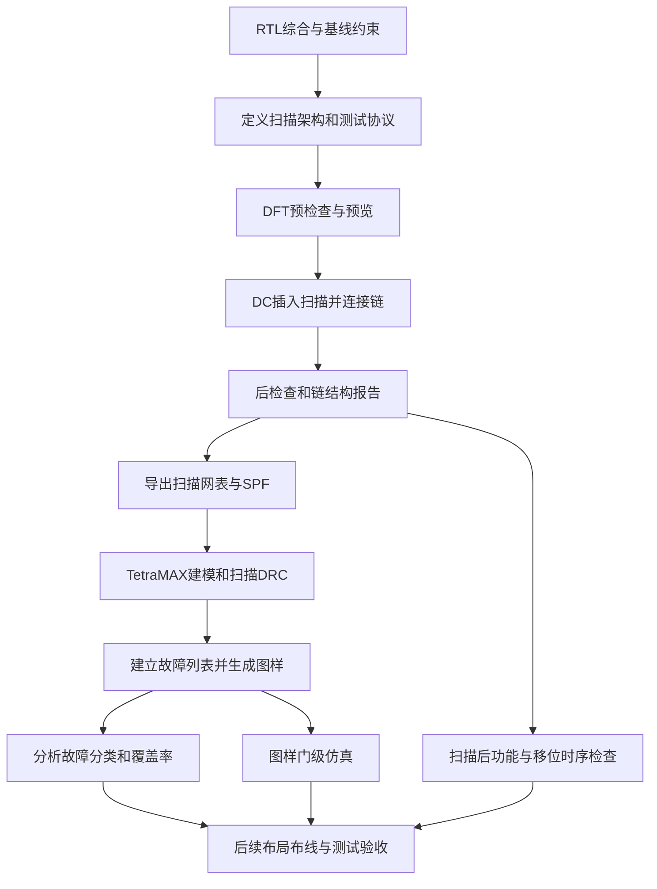

# NPU扫描链与ATPG：流程、知识点和面试回答

整理日期：2026-10-19。适用于理解本项目后准备数字IC、中端或DFT岗位面试。本文整理既有实验与公开面经，没有启动新实验、修改RTL或调整ATPG参数。

回答建议按“目的 → 原理 → 实际做法 → 数据 → 未完成项”展开。下文示例是帮助理解的表达，面试时应按自己已经掌握的内容回答。

## 1. 先记住这组项目事实

| 项目 | 已核对结果 |
|---|---|
| 插链工具 | Synopsys DC/DFT Compiler O-2018.06-SP1 |
| ATPG工具 | TetraMAX O-2018.06-SP1 |
| 扫描结构 | MUX-D普通扫描链，16条，无硬件扫描压缩器 |
| 扫描触发器 | 75137个 |
| 实际链长 | chain_0为4697，其余15条均为4696 |
| 接口 | scan_enable、16个scan_in、16个scan_out，共33个新增信号位；未实现JTAG/TAP |
| 时钟 | 共用clk；功能约束40MHz，移位测试协议100ns即10MHz |
| 复位 | 同步、高有效reset，在当前测试协议中固定为0 |
| 扫描资格检查 | 75137个时序单元无扫描资格违规；DC仍报告16个SRAM TEST-451建模告警 |
| ATPG检查 | 显式设置SRAM黑盒后，测试协议解析和16条链追踪通过 |
| 扫描面积 | 插入前488830.015022，插入后543531.280428，库单元面积增加约11.19%；不是芯片版图面积 |
| 故障模型 | stuck-at，uncollapsed统计，总故障2747638 |
| 最新图样 | 16502条内部图样，已保存binary和STIL |
| 最新覆盖率 | Test coverage 92.19%，Fault coverage 78.58% |
| 最新停止状态 | 本轮搜索正常结束，CPU 2318.89秒，未触发3600秒预算；当前无ATPG进程 |
| 历史VCS验证 | 早期14条集合中前10条的并行装载抽样，0 mismatches；仅2次串行shift |
| 当前验证边界 | 最新16502条尚未重新做VCS验证，未完成全串行/SDF时序签核 |
| SRAM范围 | 16个硬宏阵列不在本轮逻辑扫描覆盖率内；独立MBIST实验未接入整个NPU |

早期104条、392条等结果都是历史保存点，不应作为最新数字。恢复时读入的external patterns与最终internal patterns不能相加。

## 2. 面试开场：一分钟说明项目

可以在理解后这样概括：

> 我在INT8 NPU项目中实践了基于DC/DFT Compiler和TetraMAX的普通扫描测试流程。目的是提高内部寄存器的可控制性和可观察性，为制造故障测试提供访问通路。我基于综合网表定义扫描接口、测试时钟和复位条件，做预检查后构建了16条扫描链，共75137个触发器，实际链长4696到4697级。随后使用扫描网表、标准单元模型和测试协议做stuck-at ATPG，最新保存16502条图样，测试覆盖率92.19%、故障覆盖率78.58%。SRAM阵列单独划分到MBIST范围；最新图样集合的完整门级验证及扫描后时序收敛仍是后续工作。

如果问“具体做了什么”，再展开接口配置、预检查、链结构核对、协议命名问题和覆盖率分析。不需要声称手工串联了每个触发器，也不应把工具自动完成的搜索算法说成自己开发。

## 3. 原理：扫描到底改变了什么

### 3.1 普通触发器与扫描触发器

```text
功能D ─────┐
           ├─ 选择器 ── D触发器 ── Q
扫描SI ────┘     ↑
                SE

SE=0：时钟沿采样功能D
SE=1：时钟沿采样扫描SI
```

实际使用标准单元库中的扫描触发器，选择功能可以集成在单元内部。上图是功能模型，不要求版图中是一个独立MUX加一个独立DFF。

把前级Q接到后级SI：

```text
scan_in → FF0 → FF1 → FF2 → … → scan_out
```

移位时每个有效时钟沿只前进一级。扫描并没有把功能组合逻辑删除；capture阶段仍沿原功能路径计算。

### 3.2 一条图样怎样运行

| 阶段 | SE | 操作与作用 |
|---|---:|---|
| 装载Shift in | 1 | 装入ATPG指定状态，使内部故障容易激活 |
| 捕获Capture | 0 | 施加主输入和测试时钟，把故障响应捕获进寄存器 |
| 卸载Shift out | 1 | 读出捕获结果并比较；常与下一条图样的装载重叠 |

本项目为低速stuck-at实验，不能据此声称实现了at-speed transition测试。Capture采用功能连接，不代表任何capture都已按最高功能频率运行。

### 3.3 为什么能提高可测性

- 可控制性：通过扫描给内部寄存器设置所需初值，减少依靠很长功能指令序列达到目标状态的困难。
- 可观察性：故障效应被寄存器捕获后，可通过扫描读出。
- 对全扫描模型，可以把扫描寄存器的输出看作伪主输入、输入看作伪主输出，降低时序ATPG的复杂度；宏、非扫描状态及约束仍会影响实际问题。

举例：`Y=A&B`的Y stuck-at-0，需要A=B=1激活差异，并把Y的差异传播到可比较输出。只让故障位置产生不同值，却无法传播出去，仍不能检出。

## 4. 完整流程：每一步解决什么问题



上图包含工业流程需要的后续环节；本项目完成范围以第1节为准。

### 4.1 输入与输出

| 阶段 | 主要输入 | 主要输出 |
|---|---|---|
| DC插链 | 已综合DDC、标准单元/SRAM DB、设计约束、测试架构 | 扫描Verilog网表、DDC、SPF、链和DRC报告 |
| TetraMAX | 扫描网表、标准单元Verilog模型、SRAM测试模型/黑盒定义、SPF | 模型image、故障列表、binary图样、STIL、覆盖率报告 |
| VCS图样验证 | 与图样匹配的扫描网表、真实单元模型、生成的testbench/数据 | mismatch结果和仿真日志；需要时增加SDF时序验证 |

DB主要供综合/时序工具读取；Verilog单元模型用于ATPG建模或仿真，具体用途要区分。SPF描述测试信号、扫描结构和过程；本项目SPF使用STIL语法，但它不是全部生成图样。

### 4.2 项目中的实际命令顺序

源文件：[npu_insert_scan.tcl](/home/ICer/eda/npu-vcs-learning/scripts/dft/npu_insert_scan.tcl)。这是执行流程摘要，省略库路径和16组端口循环，不是一份独立可运行脚本。

```tcl
read_ddc ../npu_precheck_40mhz_20261018/npu_40mhz.ddc
current_design npu_top
link

set_scan_configuration -style multiplexed_flip_flop -chain_count 16 -clock_mixing no_mix
# create_port、set_dft_signal、set_scan_path：定义SE、SI/SO以及每条链。
# 配置100ns测试周期、clk波形和reset=0。
create_test_protocol

set_dft_insertion_configuration -synthesis_optimization none
dft_drc -pre_dft -verbose
preview_dft
insert_dft
change_names -rules verilog -hierarchy

dft_drc -verbose
report_scan_path -view existing_dft -chain all
report_scan_path -view existing_dft -cell all
write -format verilog -hierarchy -output npu_scan.v
write -format ddc -hierarchy -output npu_scan.ddc
write_test_protocol -test_mode Internal_scan -output npu_scan.spf -names dc_shell
```

| 命令 | 面试中要说明的作用 |
|---|---|
| `link` | 把实例引用与已经读入的设计、库单元定义关联起来 |
| `set_scan_configuration` | 定义扫描风格、链数和时钟混用策略 |
| `set_dft_signal` | 定义测试时钟、使能、数据及常量信号的角色和极性 |
| `-view spec` | 描述希望工具建立的测试结构/信号 |
| `-view existing_dft` | 描述已有信号或查看已经建立的DFT结构 |
| `create_test_protocol` | 生成初始化、移位和捕获所需的过程描述 |
| `dft_drc -pre_dft` | 在插入前发现时钟、复位、单元模型等可测试性问题 |
| `preview_dft` | 查看插入计划，本身不替代实际插入 |
| `insert_dft` | 实际建立扫描结构和连接 |
| `report_scan_path` | 检查已建立链的入口、出口、长度及单元 |
| `write_test_protocol` | 给ATPG输出与网表接口匹配的测试协议 |

`-synthesis_optimization none`关闭插入后的综合优化，并不关闭扫描替换。现在的链路检查结果不能代替扫描后STA。

TetraMAX核心顺序为：

```tcl
read_netlist $stdcell_v -library
read_netlist $sram_v -library
read_netlist npu_scan.v
set_build -black_box TS5N28HPCPSVTA32X64M2F
run_build_model npu_top
run_drc npu_scan.spf
set_faults -model stuck -report uncollapsed -summary verbose -fault_coverage
add_faults -all
run_atpg -auto_compression
report_summaries
```

此段也只是流程摘要，实际路径、停止策略和保存步骤见跟踪脚本。

## 5. 扫描基础：面试问法和回答

### 问题1：功能仿真已经通过，为什么还要DFT？

功能仿真主要验证设计意图与RTL实现。制造测试面向每颗实际芯片上的制造缺陷；普通功能输入不一定容易把内部故障激活、传播并观察到。扫描增加内部状态的可控制性和可观察性，让ATPG能够系统地产生制造测试条件。

追问时说明：stuck-at是故障抽象，不是全部物理缺陷；高stuck-at覆盖率也不等于所有缺陷都能检测。

### 问题2：扫描触发器和普通触发器有什么区别？

扫描触发器增加扫描输入与选择能力。SE=0走功能D，SE=1走扫描SI；前级Q到后级SI组成移位链。代价包括单元面积、功能路径延迟、SE/时钟负载和移位功耗，需要重新检查时序。

### 问题3：为什么选16条链，而不是1条或64条？

本项目选16条作为学习阶段的架构配置，把75137个触发器均衡到4696～4697级。更多并行链通常缩短装载时间，但需要更多测试通道/接口，并带来布线、功耗和实现约束。16不是已经联合优化证明的最优点。

本项目新增16个SI、16个SO和1个SE，共33个信号位；共用已有clk。这是模块端口数量，不是已经落实的封装引脚数。压缩架构可改变外部通道与内部链数的对应关系，但本项目没有插硬件压缩器。

### 问题4：链长不均衡有什么问题？测试时间怎样估计？

并行移位的时间通常由最长链决定，短链会有等待或填充，因此倾向均衡长度。本项目最长4697，在10MHz下装满一次约469.7微秒。

如果P条图样，每条C个捕获周期，装入/卸出重叠，忽略初始化和协议开销，可粗略估计：

```text
总周期 ≈ (P+1) × 最长链长 + P × 捕获周期数
```

不能默认每条图样都“装入L+卸出L”简单乘二，也不能把ATPG软件搜索耗时当成芯片执行图样的测试时间。实际时长以生成协议、测试机和图样统计为准。

### 问题5：SE和test_mode一样吗？

SE通常选择功能D或扫描SI，shift时有效，capture时按协议切回功能输入。test_mode通常标识更大范围的测试工作模式，在shift和capture期间都可能有效，用于门控旁路、隔离等控制。具体定义看设计和协议。本项目有SE，未新增独立test_mode接口。

### 问题6：复位有什么注意事项？

首先确认同步/异步、高有效/低有效、作用对象与测试模式行为。扫描装载期间复位意外有效会破坏扫描状态，异步复位尤其需要控制。测试中可能保持无效，也可能专门测试复位置位/释放行为，取决于协议和故障模型。

本项目reset是同步高有效，协议中保持0；不能误声明为异步Reset。也不能未经分析就删掉功能复位。

### 问题7：DFT DRC通过，是否代表覆盖率100%？

不是。DFT DRC检查模型与测试结构是否符合规定，例如时钟能否控制、链是否可追踪。ATPG还要寻找能激活并观察具体故障的图样。结构合法不保证每个故障可检测，也不证明物理时序、所有图样或硅片测试通过。

本项目必须说清楚：75137个时序单元无扫描资格违规，但DC还有16个SRAM建模告警，不能说所有DRC零告警。

### 问题8：插入扫描后，原来的功能会变吗？

设计目标是在正常模式保持原功能，扫描模式提供测试访问。但替换扫描单元、增加控制和布线后，功能等价性与时序都需要复查。不能仅凭“SE=0”这一原理就代替功能验证或等价检查。

## 6. 时序和低功耗：需要能画图解释

### 问题9：为什么扫描移位容易发生hold违例？降低频率有用吗？

相邻扫描触发器间的数据路径可能很短，时钟偏斜可能使后级在同一次移位沿采到前级刚变化的新数据。常见同沿shift hold问题取决于最小数据延迟与时钟相对到达时间，降低移位频率通常不能修复。

针对具体路径可以增加数据延迟、改善时钟偏斜、调整连接或必要时引入lock-up元件。链重排与布局布线后仍要重新分析。

只考虑同频同沿、定义skew为接收时钟到达减发射时钟到达，忽略其它复杂效应时：

```text
setup：Tcq_max + Dmax + Tsetup + Usetup ≤ T + skew
hold ：Tcq_min + Dmin ≥ Thold + skew + Uhold
```

接收时钟更晚通常有利setup、对hold更不利。这个简化关系不是所有多时钟、异沿或锁存器路径的通用公式。

### 问题10：lock-up latch有什么作用？

它在扫描移位通路上按适当相位暂存数据，帮助处理跨时钟域/不利时钟偏斜下的shift hold问题。选择位置、透明电平和时钟关系需要分析；它不是用于任意异步数据传输的通用同步器。

同一条链混不同边沿触发器时，也要安排移位边沿顺序，确保接收端看到正确的旧数据。不能机械回答所有跨域都随便加一个锁存器就行。

本项目使用`-clock_mixing no_mix`且报告中共用clk，没有实际完成复杂多时钟lock-up实验。这部分属于拓展知识。

### 问题11：门控时钟如何与扫描兼容？

shift阶段必须让相关扫描单元得到规定的时钟。ICG通常提供测试控制，测试模式下按架构使门控可控制；capture阶段还要满足测试协议和功耗策略。要检查控制信号、门控时序和扫描DRC。

`scan_enable`只在移位阶段有效，与整个测试期间有效的`test_mode`不同，不能不加分析地互换。本项目的低功耗门控方案尚未实施，不能说已经完成门控DFT验证。

### 问题12：为什么测试功耗可能高？怎么处理？

扫描移位和捕获可能同时使大量节点翻转，超过正常工作活动，增加动态功耗并造成IR drop风险。可以从移位频率、链/时钟分组、低翻转图样、捕获切换约束及架构等方面处理，具体需评估覆盖率、图样数和测试时间。扫描链数多不代表所有场景下功耗必然按相同比例增加。

## 7. ATPG和覆盖率：用实际数字回答

### 问题13：stuck-at与transition有什么区别？

stuck-at把故障位置建模为永久0或1，通过激活并传播逻辑值差异检测。transition关注slow-to-rise/slow-to-fall，需要建立一次转换，并在规定时间内捕获，因此涉及launch/capture时序，通常需要at-speed测试机制。

LOC是capture操作发起转换后再捕获，LOS是最后一次shift发起转换再捕获；时钟与SE切换要求不同。本项目只完成当前stuck-at实验，没有实现LOC/LOS、OCC或transition验收。

### 问题14：Test coverage和Fault coverage哪个重要？

本项目默认PT按50%计分，AN/AX不给信用，使用uncollapsed统计：

```text
Fault coverage = (DT + 0.5×PT) / 总故障
Test coverage  = (DT + 0.5×PT) / (总故障 − UD)
```

这里的简式针对本项目设置；工具允许调整计分和统计口径。Test coverage看排除UD后可检测故障的覆盖情况，Fault coverage看全部已建模故障的检测比例；验收应同时说明故障模型、范围、排除项与图样验证结果。

当前总数2747638，DT=2159067、PT=36、UD=405530：分子2159085，得到78.58%和92.19%。两者不表示芯片良率、可测芯片比例或覆盖面积。比较不同项目还需核对折叠方式、宏模型、常量/未用逻辑处理与约束。当前有未用门删除提示M245，因此也不能把此故障集合称为所有物理缺陷。

### 问题15：DT、UD、AU、ND分别是什么？

| 类别 | 本轮数量 | 回答要点 |
|---|---:|---|
| DT | 2159067 | 已检测；包括仿真检测DS和推理检测DI |
| PT | 36 | 可能检测，当前只给50%计分，不等于明确检测 |
| UD | 405530 | 不可检测，包括同值固定UT、恒值阻断UB和冗余UR等 |
| AU/AN | 18824 | 当前ATPG条件下不可测、未被证明冗余，当前不给检测信用 |
| ND | 164181 | 尚未检测，其中NC=10132、NO=154049 |

ND不是已证明永远不可测。AU也不能简单等同于没有物理风险的冗余。一个stuck-at故障不可测，不代表对应单元或连线可以整块删除。

### 问题16：为什么覆盖率没到99%？怎么提高？

本项目不能把原因笼统归结为时间不足。最新一轮在2318.89 CPU秒正常结束，低于3600秒预算；默认abort_limit=10，末行有大量搜索abort，同时存在黑盒X来源和测试约束。

合理顺序是：按模块统计NC/NO/AN → 检查时钟、复位、约束、非扫描单元和X传播 → 对困难故障提高搜索力度做对照 → 必要时考虑测试点/旁路等设计措施 → 复查图样、功耗和时序。

本机官方定义中，abort_limit限制一次Basic/Fast ATPG努力中的remade decisions，默认10；它不是运行10秒，也不是总故障只允许失败10个。提高它可能检出困难故障，也可能主要增加耗时，应做有预算的对照。上述进一步分析与优化尚未实施。

### 问题17：怎样判断收敛？

先区分达到预算、当前参数下本轮搜索结束、工程验收完成。需要比较新增检测故障、覆盖率、图样数量和运行成本，并解释剩余故障、验证生成图样。

本轮相对起点新增DT 36043，UD/UR增加32084，图样增加6208。因此Test coverage提高同时包含真实新增检测和冗余证明改变分母的作用。不能仅凭92.19%提高了就说都是新增检测，也不能因工具退出就说达到了验收。

### 问题18：`run_atpg -auto_compression`意味着插了扫描压缩器吗？

不是。这里是ATPG的软件图样优化/合并策略。硬件扫描压缩需要网表中存在相应解压、响应压缩等结构，并有对应模型和协议。本项目实际是16条普通直接扫描链，未实现硬件扫描压缩。

### 问题19：SRAM为什么不扫描？X有什么影响？

硬SRAM内部存储位不是普通标准单元DFF，不能直接按DFF逐个替换成扫描单元。本项目的16个宏在逻辑ATPG中显式作黑盒，输出保持未知X；阵列测试属于单独MBIST范围。

这并不表示连接SRAM的外围逻辑全部不用测。需要评估地址、控制、数据通路的测试访问和黑盒X传播影响，必要时设计旁路或隔离并验证。当前没有完成这些结构改进，也不能把X随意当常量以提高数字。

ATPG中可自由选择的don't-care位，与模型中无法确定的X来源，含义不同。响应中X还可能影响比较或硬件压缩器的可观察性。

## 8. 验证和排错：面试最容易追问到细节

### 问题20：图样生成完，为什么还要VCS仿真？

ATPG依据测试模型搜索图样，仿真还需要核对真实单元模型、网表、图样端口/顺序、复位、时钟过程和预期响应的一致性。后续加入SDF还要验证时序相关问题。

应区分三层：扫描DRC/链追踪；并行装载的图样逻辑验证；真实全串行移位与时序验证。并行装载可以节省仿真时间，但不能替代完整扫描连线的串行验证。

本项目历史VCS通过的范围是早期14条集合中的前10条，并行装载、2次串行shift、0 mismatches；最新16502条还没重新仿真。不能回答“所有图样和扫描时序都PASS”。

### 问题21：扫描仿真失败，先查什么？

先确认失败属于移位链还是capture响应，再定位到具体链、bit、图样和周期。核对网表与图样是否同一版本，SI/SO顺序、链长、SE、reset和时钟边沿是否匹配，检查X与单元模型；有SDF时进一步检查setup/hold及采样点。

移位通路可用全0/全1、walking-one或交替序列等简单链测试定位，检查位移量和首个错误位置；复杂故障还需正式chain diagnosis。不能一看到X就改模型或屏蔽比较。

### 问题22：项目里一个真实遇到的问题是什么？

可讲“测试协议端口命名”：有四个AXI ID端口宽度为`[0:0]`，原SPF导出采用Verilog命名，转义后的名字与TetraMAX识别的网表端口不一致，出现端口匹配问题。核对网表和SPF后，使用`write_test_protocol -names dc_shell`重新导出，协议解析和16条链追踪通过；没有为规避错误而改变功能端口宽度。

回答结构：现象（找不到测试端口）→ 排查（对照网表和SPF）→ 原因（单bit总线命名转义）→ 修复（导出命名规则）→ 验证（协议解析和链追踪）。

另一类真实问题是长ATPG运行只留下日志、没有可恢复图样。后续加入故障/图样检查点和正常退出保存，配合image恢复及独立结果目录。可讲这段经历，但旧进程消失的根因没有确定，不应编造为已定位的终端退出或工具崩溃。

### 问题23：JTAG、边界扫描、内部扫描和MBIST有什么区别？

- 内部扫描：访问内部扫描触发器，支持逻辑故障测试。
- JTAG/TAP：一种测试访问控制机制，可用于访问边界扫描或其它测试数据寄存器。
- 边界扫描：主要围绕I/O及板级互连测试，不等同于把所有内部触发器接起来。
- MBIST：通过控制器和存储器算法对阵列执行读写检查，可涉及独立的修复机制。

本项目有内部扫描；尚无JTAG/TAP。MBIST有单宏独立实验，尚未接入NPU全部16宏，不能说整芯片MBIST完成。

## 9. 手写代码题：先掌握4位示例

这是教学用的4位MUX-D扫描寄存器模型，不是项目实际替换扫描单元的RTL，也没有在本次整理中启动编译。

```systemverilog
module scan_example (
    input  logic       clk,
    input  logic       reset,
    input  logic       scan_enable,
    input  logic       scan_in,
    input  logic [3:0] functional_d,
    output logic [3:0] q,
    output logic       scan_out
);
    assign scan_out = q[3];

    always_ff @(posedge clk) begin
        if (reset)
            q <= 4'b0000;
        else if (scan_enable)
            q <= {q[2:0], scan_in};
        else
            q <= functional_d;
    end
endmodule
```

要能解释：本例同步高有效reset优先；shift时必须保持reset无效；SE=0时采样功能输入。扫描输入先进入q[0]，逐拍到q[3]。

手动推演：初值0000，连续移入1、0、1、1，q依次为0001、0010、0101、1011。再将SE置0、functional_d置0101，给capture沿后q为0101，后续移位时从scan_out依次读出捕获值，注意在正确边沿前后采样。

如果要求写testbench，应检查：同步复位行为、每一拍shift的q、capture结果、串行读出的bit顺序，以及shift-out与下一次shift-in重叠。驱动信号时避开被采样的上升沿，防止测试平台竞争。

## 10. 公开面经如何参考

以下用于了解题型，不代表任何公司的现行固定题库。技术回答由本项目证据和官方资料核对，不照抄面经中的答案。

| 公开样本 | 可参考的题型 |
|---|---|
| [2022年：英伟达NV数字IC DFT岗位](https://www.nowcoder.com/discuss/353159441803583488) | 扫描触发器与普通触发器、插链、扫描故障、移位寄存器手写；也涉及约束、时序和低功耗 |
| [2025年：字节芯片物理设计/DFT组面经](https://www.nowcoder.com/discuss/793957840258932736) | SCAN流程、复位注意事项、异步复位同步释放代码、setup/hold计算及CDC |
| [2020年：英伟达实习DFT工程师](https://www.nowcoder.com/discuss/353156566864044032?sourceSSR=subject) | 扫描实现、BIST/边界扫描、移位输入模块和testbench；本次可访问搜索摘录，正文直链返回内容不完整 |

这些样本说明，复习应同时准备DFT原理、项目细节、时序和基础RTL代码，不能只背工具命令。不能据这几个样本声称某题的统计出现频率或具体公司的录用标准。

## 11. 复习顺序与自测

第一轮先做到能画MUX-D扫描单元、解释shift/capture、说完整插链输入输出、算出16条链长度和测试时间，并解释同步复位的测试处理。

第二轮掌握覆盖率公式、DT/PT/UD/AU/ND、故障激活与传播、X来源、shift hold与lock-up原理，以及为什么低速stuck-at不等于at-speed测试。

第三轮按自己的项目演练：一分钟概述；三分钟解释脚本；五分钟讲一个真实排错问题；准确说明DRC告警、VCS验证范围和最新覆盖率的边界。

优先自测10题：

1. 为什么功能正确还需要制造测试？
2. 画出扫描触发器，说明SE=0/1的行为。
3. 用4位链演示装载、捕获和读出。
4. 16条链如何平衡，测试时间与链数怎样相关？
5. reset如何处理，为什么不能把同步复位声明成异步复位？
6. 扫描链DRC、ATPG故障仿真和VCS图样仿真分别证明什么？
7. 为什么92.19%与78.58%都正确？
8. 为什么降低时钟频率通常不能解决同沿shift hold？
9. SRAM黑盒为什么会产生X，普通扫描与MBIST如何划分？
10. 你实际修复过什么，修复后具体检查了什么？

## 12. 项目证据与官方参考

- [扫描插入脚本](/home/ICer/eda/npu-vcs-learning/scripts/dft/npu_insert_scan.tcl)
- [预检查脚本](/home/ICer/eda/npu-vcs-learning/scripts/dft/npu_precheck.tcl)
- [实际链结构](/home/ICer/eda/npu-vcs-learning/build/dft/npu_scan_20261018/reports/scan_chains.rpt)
- [扫描后DRC](/home/ICer/eda/npu-vcs-learning/build/dft/npu_scan_20261018/reports/dft_drc_post.rpt)
- [最新16502条图样的ATPG日志](/home/ICer/eda/npu-vcs-learning/build/atpg/npu_continue_20261019_03/continue_04.log)
- [历史VCS抽样日志](/home/ICer/eda/npu-vcs-learning/build/atpg/npu_checkpoint_test_20261018/vcs_sim.log)
- [实际ATPG建模脚本](/home/ICer/eda/npu-vcs-learning/scripts/atpg/npu_stuck_at.tcl)
- [恢复脚本](/home/ICer/eda/npu-vcs-learning/scripts/atpg/npu_resume_stuck_at.tcl)
- [图样搜索与保存脚本](/home/ICer/eda/npu-vcs-learning/scripts/atpg/npu_generate_patterns.tcl)
- [TetraMAX官方覆盖率定义](/home/synopsys/txs/O-2018.06-SP1/doc/test/tmax_olh/Content/tmax_ug/a.test_concepts/man_coverage_calculations.htm)
- [TetraMAX官方故障分类](/home/synopsys/txs/O-2018.06-SP1/doc/test/tmax_olh/Content/man_fault_classes.htm)
- [TetraMAX官方搜索力度定义](/home/synopsys/txs/O-2018.06-SP1/doc/test/tmax_olh/Content/man_set_atpg.htm)
- [Synopsys ATPG产品说明](https://www.synopsys.com/implementation-and-signoff/test-automation/testmax-atpg.html)
- [Siemens扫描结构说明](https://www.siemens.com/en-us/products/ic/tessent/test/scanpro/)
- [原始脚本逐段教程](/home/ICer/eda/npu-vcs-learning/docs/dft_scan_atpg_mbist_guide.md)
