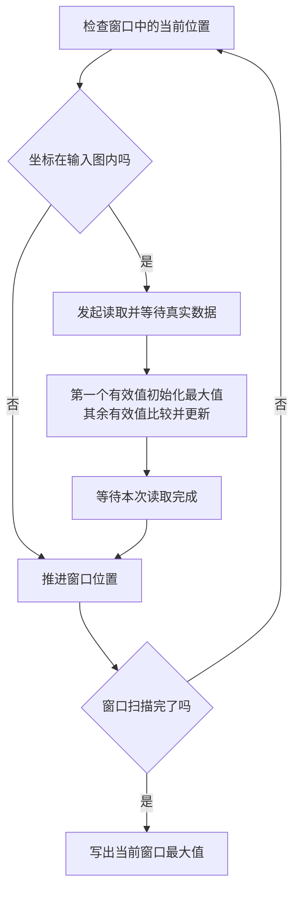

# 最大池化补边：只处理真实存在的输入

本次修改解决独立最大池化在图像边缘的处理问题。ResNet-50 首个池化使用 3×3 窗口、步长2，输入112×112、64通道，在右侧和下侧各补1格后输出56×56、64通道。窗口、步长和四侧补边均由软件逐条任务指定。

补边是窗口几何的一部分，不在外存中创建一圈零，也不向最大值比较器送入数值零。越界位置跳过读取和比较。

## 为什么多一个“收到有效数据”的标志

例如输入只有下面四个负数，池化窗口在上面、左面各超出一格：

```text
×   ×   ×
×  -7  -3
×  -5  -9
```

`×` 表示图外的位置，不是数值零。扫描窗口时：

1. 跳过前面的图外位置，不发起读取。
2. 读到第一个真实数字 -7，直接把它作为当前最大值。
3. 读到 -3，当前最大值更新为 -3。
4. 后续 -5、-9 都小于 -3，最大值保持不变。
5. 窗口扫描完毕，写出 -3。

如果简单把最大值初始化为零再不断比较，所有负数都小于零，就会错误地写出零。因此新增 `max_valid_q`，记录当前窗口是否已经收到至少一个有效样本。每个新窗口、每组通道开始前清零；第一个有效样本直接赋值，后续才比较。

一次读取包含同一空间位置的四个通道，它们共享空间有效性标志，四个最大值分别作有符号8位比较。

## 状态机怎样走

主要逻辑位于 `rtl/compute/npu_pool_engine.sv`，顶层只负责传递配置。



- `ST_SAMPLE_CHECK`：检查当前样本的真实输入坐标。有效才进入原有读取状态；越界直接进入推进状态。
- `ST_RD_REQ / ST_RD_DATA / ST_RD_DONE`：沿用读取请求、接收数据、等待事务完成的流程。仅收到有效数据时更新最大值。
- `ST_SAMPLE_NEXT`：越界位置没有读取事务，在这里直接推进。有效样本在 `ST_RD_DONE` 等读取完成后推进；两处采用相同窗口顺序，窗口结束后写回结果。
- 原有写回状态等待写响应后，才开始下一组通道或下一个输出位置。

真实输入坐标由下式计算，其中窗口内行列从0开始：

```text
输入行 = 输出行 × 纵向步长 + 窗口内行 − 上补边
输入列 = 输出列 × 横向步长 + 窗口内列 − 左补边
有效 = 0 ≤ 输入行 < 输入高，并且 0 ≤ 输入列 < 输入宽
```

坐标先扩展为64位有符号数再计算，避免上侧、左侧的负坐标绕成很大的无符号地址。越界样本不发起读请求。外部接口暂时不能接收数据时，状态、位置和最大值保持，等待接口恢复。

补边全零时保留原来的直接读取路径，不增加边界检查状态周期；旧模型的执行周期和总线流量保持原值。

## 软件如何指定

仍使用64字节描述符，独立最大池化的 opcode 为3：

| 字编号，从0开始 | 独立最大池化含义 |
|---|---|
| 1、2、3 | 实际输入高、宽、通道数 |
| 10 | 四侧补边，最低到最高字节依次为上、左、下、右 |
| 11、12 | 必须为0 |
| 15 | 窗口高、窗口宽、纵向步长、横向步长；0兼容2×2、步长2 |

```python
from target import pack_pool_config, pack_pool_padding, pool_output_shape

pool['pool_config'] = pack_pool_config(3, 3, 2, 2)
pool['words10_12'] = [pack_pool_padding(bottom=1, right=1), 0, 0]
assert pool_output_shape(112, 112, pool['pool_config'],
                         pool['words10_12'][0]) == (56, 56)
```

四侧补边各占一个字节，范围0～255，并要求每侧小于对应窗口尺寸，以避免完全落在补边中的空窗口。窗口与步长仍为1～255。输出采用向下取整规则：

```text
输出高 = (输入高 + 上补边 + 下补边 − 窗口高) // 纵向步长 + 1
输出宽 = (输入宽 + 左补边 + 右补边 − 窗口宽) // 横向步长 + 1
```

全零补边兼容旧任务。窗口比实际输入大时，只要补边后几何合法且窗口含有真实输入，也可执行。非法窗口/步长、过大补边、尺寸溢出和外存地址溢出在读取前报错。全局平均池化要求补边配置为零。

## 与流式融合的关系

本轮支持的是独立池化：卷积先写外存，池化再读取真实样本。软件遇到非零池化补边时保留这两条任务，并报告融合不支持补边，不会悄悄丢弃补边字段。

流式卷积—池化融合目前仍使用不补边的 VALID 规则。本轮同时补齐了此前中间融合引擎遗漏的窗口/步长配置接线，并验证3×3、步长2的 VALID 融合；这不等于已支持带补边融合。缓存容量和卷积尾块限制仍需后续处理。

## 验证入口

```bash
make test TEST=pool2d_configurable_tb CONFIG=padding
make test TEST=pool2d_configurable_tb CONFIG=padding-resnet PARAMS="RUN_RESNET=1"
make test TEST=maxpool_padding_npu_tb CONFIG=padding-system RUN_ARGS="+WRITE_GAP=3"
```

真实尺寸用例逐字节检查112×112×64到56×56×64的输出，同时检查每个读取地址处于实际输入张量范围内。其有效32位池化读取为446,224次，输出写入为50,176次，补边位置不产生读取。这里统计池化单元的逻辑32位读取，不等同于整机64位总线上的物理读拍。

单元用例另覆盖全负值边缘、窗口第一个位置无效、四侧不对称补边、输入小于窗口、不同方向步长、配置锁存、反压、非法任务拒绝及恢复。系统用例从外存描述符开始运行，覆盖8种配置与拒绝场景。实际运行状态及完整日志见 [验证记录](validation.md)。本次没有运行 ResNet-50 整网。
